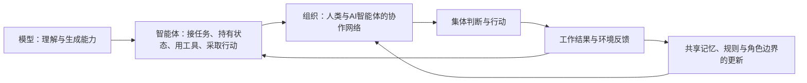

# 研究底稿：AI 的局部产出如何成为组织能力？

**状态：** 初始框架，待案例和文献检验  
**更新：** 2026-11-16

## 核心问题

组织怎样把 AI 的局部产出，转化成可持续的集体判断、协作和学习能力？

## 暂定判断

AI 生成的答案、建议或分析，只有经过组织里的解释、验证、共享、协调和复盘，才可能成为集体能力。组织学习的关键，不是“有多少人用了 AI”，而是一次人机协作是否改变了下一次任务中团队能共同知道什么、如何分工、怎样判断，以及遇到新问题时如何调整。

下面的机制链是本项目的**待检验综合框架**，不是现成结论：

这里补上上一轮讨论发现的关键层：**智能体**。模型是能力来源，智能体是能承担角色和任务的行动单元，组织则安排这些行动单元如何互相交接、共享记忆、使用权限并对结果负责。详细定义见[模型—智能体—组织三层框架](03-model-agent-organization.md)。

### 五个可能的转化环节

1. **解释与验证：** 人能判断 AI 输出适用于什么情境、依据是什么、还缺哪些信息，并纠正错误。
2. **共享与协调：** 重要上下文、决策依据和任务状态进入共同工作流程，相关人员知道谁负责判断、接手和升级。
3. **知识沉淀：** 经验证的经验进入组织可检索、可更新的记录、范例、流程或“谁懂什么”的团队记忆，而非只留在个人聊天记录里。
4. **结果反馈：** 将 AI 建议与实际结果对照，识别有效条件、失效边界和异常案例。
5. **组织调整：** 根据反馈更新任务分配、AI 使用边界、培训和决策权，让后续团队能用上前几次的经验。

## 目前可用的研究依据

| 研究 | 发现 | 对本问题的意义 |
|---|---|---|
| [Brynjolfsson、Li 与 Raymond，《Generative AI at Work》，QJE，2025](https://doi.org/10.1093/qje/qjae044) | 一家大型客服业务中，5,172 名员工使用 AI 助手后，平均每小时解决的问题数提高 15%；收益更多出现在经验较少的员工。作者也发现 AI 帮助员工学习，并认为它可能传播高绩效员工的做法。 | 提供现场证据：AI 可以把部分个人经验扩散给新手。但研究关注一个业务场景，不能单独证明跨团队的组织记忆如何形成。 |
| [Dell’Acqua 等，《Navigating the Jagged Technological Frontier》，HBS Working Paper，2023](https://www.hbs.edu/ris/download.aspx?name=24-013.pdf) | 758 名顾问参与随机实验。AI 在其能力范围内的任务上提升速度和质量；在实验设定的能力范围外任务上，使用 AI 的参与者正确率低于对照组。 | 集体学习首先要求组织知道“哪些任务可以交给 AI、哪些需要谨慎升级”，而且这个边界会变化。 |
| [Figge、Anderson 与 Lewis，《AI-human learning systems》，Strategic Organization，2025 在线发表](https://doi.org/10.1177/14761270251385860) | 作者用系统动力学模型分析个人、集体和 AI 的学习与遗忘。模型显示，个人知识增加若造成过度专门化、沟通与协调下降，集体知识可能减少，长期表现也可能下滑。 | 提醒我们区分个人学习和集体学习。该研究是理论与计算模型，不是对真实组织的因果检验。 |
| [Kolbjørnsrud，《Designing the Intelligent Organization》，California Management Review，2024](https://doi.org/10.1177/00081256231211020) | 提出人机组织设计的六项原则：增益、适配、替代、多样性、协作和解释。 | 可用来补充任务设计、人机角色和解释责任等组织条件。 |

## 初步命题

以下是供研究使用的假设，不应当作已有研究已经证实的事实。

- **命题一：** AI 对个人任务的帮助，只有在输出经过情境化验证并被他人复用时，才更可能转化为集体知识。
- **命题二：** 任务相互依赖越高，共享上下文、清楚的交接和决策责任越重要；只给个人发工具，可能同时提高个人速度、增加团队协调损耗。
- **命题三：** 组织保留复盘与纠错环节，可能更容易把 AI 的成功案例和失败边界转化为下一轮决策规则。
- **命题四：** 短期任务产出与长期集体学习可能存在张力。自动化越多，不代表组织越会处理例外、新情境和跨专业协作。

## 研究设计草案

建议先从一个团队协作密集、结果可观察的知识工作场景切入，例如客服、产品研发或专业服务团队，追踪数月而不是只测一次任务。

比较三种工作安排：

1. **个人助手：** 员工各自使用 AI，组织不额外改变交接和复盘流程。
2. **嵌入工作流：** AI 输出保留来源和决策记录，进入共同任务状态与交接流程。
3. **嵌入加学习闭环：** 在第二种安排上增加定期抽查、错误复盘、知识更新和任务边界调整。

观察四类结果：

- **即时表现：** 速度、质量、返工率、错误率。
- **知识扩散：** 新手是否更快达到熟练水平，经验是否跨成员和班组转移。
- **协作质量：** 交接等待、重复工作、信息遗漏、跨专业协调成本。
- **适应能力：** 遇到罕见或变化中的问题时，团队能否识别 AI 局限、纠正判断并修订流程。

关键方法要求：把任务难度、AI 是否适用、员工经验、团队协作依赖程度一起记录；单看使用率或满意度不足以判断组织是否学会了。

## 下一步要回答的具体问题

1. 哪些知识需要变成共享记录，哪些保留在专家判断中更合适？
2. 谁来验证 AI 产出，谁有权将它写进组织流程？
3. 如何识别“新手被赋能”与“新手依赖 AI、没有形成判断力”的差别？
4. 何种任务适合自动化，何种任务应保留人为练习与团队复盘？

## 初步参考文献

- Brynjolfsson, E., Li, D., & Raymond, L. R. (2025). [Generative AI at Work](https://doi.org/10.1093/qje/qjae044). *The Quarterly Journal of Economics*, 140(2), 889–942.
- Dell’Acqua, F., et al. (2023). [Navigating the Jagged Technological Frontier](https://www.hbs.edu/ris/download.aspx?name=24-013.pdf). Harvard Business School Working Paper 24-013.
- Figge, P., Anderson, E., & Lewis, K. (2025). [AI-human learning systems: Investigating the strategic role of AI for organizational learning](https://doi.org/10.1177/14761270251385860). *Strategic Organization*.
- Kolbjørnsrud, V. (2024). [Designing the Intelligent Organization: Six Principles for Human-AI Collaboration](https://doi.org/10.1177/00081256231211020). *California Management Review*, 66(2).
