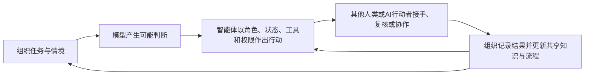

# 概念备忘：模型—智能体—组织

**状态：** 工作概念，待理论与案例检验  
**更新：** 2026-11-16

## 核心比喻

> 模型是灵魂，智能组织是身体；智能体是让“灵魂”进入工作、承担行动的行动单元。

这个比喻目前最有用的地方，是指出模型与组织之间少了一个层次。模型能力不会直接变成组织行动；它要通过一个能接任务、持有状态、使用工具、按权限行动并与他人交接的智能体，才进入实际工作。

## 三层定义

### 1. 模型：认知能力来源

模型提供语言理解、模式识别、推理或生成等能力。它决定一类智能体“可能会什么”，但模型本身不等于一个在组织里承担岗位、持续处理任务和对结果负责的行动者。

### 2. 智能体：角色化的行动者

智能体至少由以下部分共同构成：

- **角色与任务边界：** 要处理什么，什么情况必须交给人或其他智能体。
- **上下文与状态：** 当前任务知道什么、做过什么、还缺什么。
- **工具与权限：** 能查询、写入、发送或触发什么组织资源和流程。
- **行动与交接规则：** 如何提出建议、采取动作、记录依据、升级和交给下一个行动者。
- **结果反馈：** 如何知道任务是否完成、判断是否正确、知识是否过期。

所以智能体不是“模型加一个人设提示词”。它是在组织情境中具有明确职责和有限行动权的参与者。人类员工也属于行动者；组织往往是人类与 AI 智能体组成的混合网络。

### 3. 组织：行动者之间的身体与结构

组织决定不同的人和智能体如何获得信息、分配任务、交接状态、共享记忆、协调分歧、审批行动并承担后果。所谓“智能组织”，不是模型数量多，也不是智能体数量多，而是这些行动者能否形成可靠的集体判断、协作和学习。

## 从局部生成到组织能力

这条链解释了为什么“模型能力强”不保证“组织能力强”：

- **模型强、智能体弱：** 只能零散回答，不能稳定接任务、记状态或完成交接。
- **智能体强、组织连接弱：** 单个 AI 员工表现不错，但经验留在个人对话和局部任务，难以形成团队记忆。
- **组织连接强、模型或智能体不合适：** 流程和协调很完整，却可能把错误建议更快地传播出去。
- **模型、智能体、组织彼此适配：** 才有机会把局部成果复用、纠错并迁移到后续任务。

这些是用于展开研究的情形，不是已经验证的效果排序。

## 可检验命题

- **P1：** 在相同模型下，智能体拥有清晰任务状态、有限工具权限和可追溯交接时，单次输出更可能进入组织流程。
- **P2：** 即使智能体能独立完成任务，若其状态、结果和有效做法不能跨行动者共享，组织层面的知识转移仍有限。
- **P3：** 组织共享记忆和复盘机制会放大智能体的价值；但若没有验证与更新规则，也会放大错误和过时知识。
- **P4：** 智能体的自主权是重要边界条件：建议、准备动作、执行动作和修改组织状态是不同级别的权限，效果与风险应分别评估。

## 对当前客服研究的影响

现有客服研究方案固定同一模型和基础智能体角色，比较三种组织连接方式：个人任务、共享工作流、共享工作流加反馈闭环。这样先检验“组织身体如何改变同一智能体的组织价值”。

之后的研究再固定组织流程，改变智能体能力与权限，例如：

1. 只检索和建议；
2. 维护工单状态并准备交接；
3. 在授权范围内执行低风险动作，遇到例外时升级给人。

若资源允许，最后再交叉比较模型能力、智能体设计和组织嵌入程度，估计三层之间是否互补。

## 与近期研究的联系

- [Org-Agent: Beyond Personal Assistants Towards Organizational Agents (2026)](https://arxiv.org/abs/2609.34392) 将组织级语言模型智能体的能力概括为跨用户交互与决策、跨用户记忆与知识使用，并强调身份、权限、信息时效和需求冲突等组织约束。该文是预印本。
- [Multi-Agent AI Systems are Organizations (2026)](https://papers.ssrn.com/sol3/papers.cfm?abstract_id=6813862) 主张用组织理论分析多智能体系统的分工、协调等问题，并讨论混合人机组织。该文为工作论文，观点还需更多实证检验。
- [Fluid Structure, Rigid Record (2026)](https://arxiv.org/abs/2608.08516) 提出在智能体组织中区分持久记录、权限边界和动态任务团队，并报告了原型与小样本评估；作者明确指出大规模实证验证仍不足。

## 术语上的谨慎

“灵魂”是帮助思考的比喻，不表示模型有意识、稳定自我或天然责任。研究和产品分析中可把它改写为“认知能力来源”；把“智能体”定义为具有角色和有限权限的行动者；把“智能组织”定义为组织化的人机行动者网络。责任最终仍要落实到有授权的组织角色。
