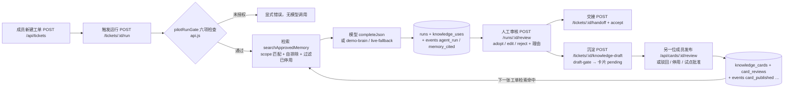

# ① 现状架构审计（Current State Audit）

- **日期：** 2026-11-20（Asia/Shanghai）
- **审计人：** 项目首席架构师（AI 阶段），只读检查
- **方法：** 逐文件阅读 `server/`（24 个 JS 模块）、`public/`（index.html + app.js 结构与路由）、`scripts/`、`deploy/`、`Dockerfile`、`compose.yaml`、`MVP_PLAN.md`、`README.md`、`PROJECT_STATE.md`，并与 `research/` 01–07 对照；所有结论附代码证据（文件:行）。
- **边界：** 本文档只描述"现在是什么"。目标架构见 ②，决策理由见 ⑦ ADR。
- **证据分级约定（全文沿用）：**
  - 【代码】= 直接阅读当前代码确认；
  - 【本机】= 代码实现且本机历史上跑通过（冒烟脚本 / 试点批次，见 PROJECT_STATE.md），本次未重新运行；
  - 【意图】= 研究文档或计划声称，代码未实现或不完全一致；
  - 【假设】= 无依据的暂定推断（本文档尽量不出现）。

---

## 1. 运行时与部署形态

### 1.1 单进程单体

- 运行时为**单 Node.js 进程**（`node server/index.js`），零框架 HTTP 服务器（`node:http`），无独立队列、无独立缓存、无第二个服务。【代码】
- 依赖仅两个运行时包：`openid-client` 6.9.0（OIDC）+ `remixicon` 4.6.0（图标）；数据库用 Node ≥22.16 内置 `node:sqlite` 的 `DatabaseSync`。【代码：package.json】
- **两种启动模式：**
  - `demo`：未配置 `MODEL_API_KEY` 时，用 `server/demo-brain.js` 本地规则生成器走通全流程（demo-brain.js L1–4）；
  - `product`：OIDC 登录、仅邀请制成员、角色、CSRF、每客户独立实例+数据库。产品模式下只运行组织模式（无个人/组织配对），模型失败显式报错、**无演示回退**。【代码：config.js modelStatus()、agent.js runPair】
- demo 模式下一张工单运行**个人+组织并行对**（`Promise.all`），这是现有代码中唯一的并行/对照执行基线。【代码：agent.js runPair → comparison_ready 事件仅 demo】

### 1.2 存储形态

- **单 SQLite 文件** `DATA_DIR/app.db`，WAL + 外键开启；13 张表（见 ④）。【代码：db.js SCHEMA】
- `events` 表是**追加式审计表**（append-only），不是事件溯源：状态变更直接写主表，事件用于审计与派生查询（`json_extract`）。【代码：store.js 各 update 语句 + addEvent 并存】
- 检索不走 SQLite FTS5，而是**进程内 JS BM25 风格评分**（`server/retrieval.js`，166 行），每次查询全量扫描语料。设计理由写在文件头注释：CJK 分词、语料小、可解释性。【代码】
- 运行中服务（不得重启）：主库 4173、隔离副本 4182/4186、试点 4192/4193/4195。【本机，PROJECT_STATE.md；本次审计未触碰任何 data/*.db】

### 1.3 部署单元

- Docker 镜像 `node:24-bookworm-slim`，非 root 用户，read_only 容器 + tmpfs + cap_drop ALL + pids_limit 128 + 健康检查 `/api/ready`。【代码：Dockerfile、compose.yaml】
- 密钥只经 Docker secrets 文件注入（`OIDC_CLIENT_SECRET_FILE`、`MODEL_API_KEY_FILE`）；数据卷 `product-data`，备份走 bind 目录 `BACKUP_DIR`。【代码：compose.yaml L15–26】
- 每团队一个 compose 项目（不同 `HOST_PORT` + 独立 env 文件 + 独立数据卷），示例 TLS 反代 `deploy/nginx-support.example.conf`（client_max_body_size 1m，read/send timeout 75s）。【代码】
- 代码库内已有 `scripts/workspace-data.js`（backup/verify/restore/erase，365 行）负责备份校验与带确认词的删除。【代码】

**结论：** 当前是"每客户一个容器 + 一个 SQLite 文件"的单体部署，与原则 4（单团队安全试点、独立数据库）一致；不存在需要拆除的共享多租户结构。

---

## 2. 模块清单与职责（代码事实）

| 模块 | 行数 | 职责 | 关键证据 |
|---|---|---|---|
| index.js | 254 | 启动、MIME/安全响应头、静态文件服务（含路径遍历防护）、产品库迁移前预检、优雅关闭 | index.js L57–88 SECURITY_HEADERS；L137+ serveStatic |
| config.js | 202 | `.env` 加载、NAME vs NAME_FILE 密钥互斥、DATA_DIR 规范化（realpath）、模型端点规范化（拒绝 userinfo/query/fragment）、TYPESAFE 影子开关 | config.js |
| db.js | 248 | 13 张表 SCHEMA + 三个幂等迁移（review_source / data-scope / card-revision） | db.js |
| store.js | 822 | ~60 条预编译语句；成员/工单/运行/审核/卡片 CRUD；knowledge_uses 写入；事件写入；导出 | store.js L320–355（createRun 时写 uses+memory_cited） |
| api.js | 785 | 37 条路由、认证/CSRF/角色闸门、pilotRunGate、交接视图派生、错误处理 | api.js L182–730 路由表 |
| auth.js | 327 | demo 存根 / OIDC（discovery、(issuer,subject) 身份、8h 会话、10min 登录流程、`__Host-` cookie、SHA-256 token） | auth.js |
| agent.js | 352 | SYSTEM_PROMPT v4.0-matched、输出硬校验、searchApprovedMemory（带 excludeTicketId）、runPair（demo 并行 / product 单组织） | agent.js L1–7 imports |
| llm.js | 131 | completeJson（fetch chat/completions、`redirect:'error'`、AbortController 超时→ModelUnavailableError）、checkModelConnection（≤15s、32 token、固定合成负载） | llm.js |
| demo-brain.js | 249 | 纯函数规则生成器（无模型时走通流程）、prepareHandoff 交接摘要构造 | demo-brain.js L1–249 |
| retrieval.js | 166 | BM25 风格评分：CJK 双字+拉丁 token、标题加权、categoryBoost 2.5、卡片×1.15、minScore 1.2、片段≤640 字符；**向量检索接缝 = `searchMemory(query, corpus)` 签名** | retrieval.js |
| analytics.js | 221 | 观察统计（只读查询层，与 store 分离）：modeStats/citationStats/usesCount/distinctReusedCards 等 | analytics.js |
| data-scope.js | 143 | scope/source_kind 常量、`isKnowledgeExpired`（无效日期 fail-closed）、`cardMatchesScope`（空 applies_to 永不命中）、`isAuthoritative`、scope 迁移回填 | data-scope.js |
| pilot-loop.js | 206 | 只读试点聚合（授权元数据、自排除标志、跨工单命中/引用） | pilot-loop.js |
| team-learning.js | 289 | 产品模式团队复盘视图（事件 json_extract 统计、交接等待中位数、跨任务引用） | team-learning.js |
| batches.js | 164 | 观察批次白名单（pilot-2026-11：工单 #18–27）、按 review_source_type 分桶统计 | batches.js |
| typesafe-gate.js | 88 | 影子相关性评估（仅样本工单、2500ms 超时、`applied:false` 永不过滤候选） | typesafe-gate.js |
| draft-gate.js | 40 | 知识草稿闸门：需最新组织运行+人工 adopt/edit 审核 | draft-gate.js |
| draft-lineage.js | 60 | 草稿携带同 scope 已发布卡片引用（谱系） | draft-lineage.js |
| knowledge-draft.js | 62 | 草稿正文模板 → createCard(pending) + tool_call 事件 | knowledge-draft.js |
| review-source.js | 27 | review_source_type 列迁移+回填（assistant/seed/unknown） | review-source.js |
| live-fallback.js | 15 | 模型失败时的显式"无回答"占位（零引用） | live-fallback.js |
| seed.js | 246 | 首启演示数据（7 工单/4 卡/2 草稿/2 已审 run_group，全部虚构标注） | seed.js |
| reset.js | 10 | 按 FK 顺序清空（knowledge_uses 最先） | reset.js |
| time.js | 3 | nowIso() | time.js |

前端：原生 ES-module SPA（`public/app.js` 2772 行，无框架、无构建步骤），hash 路由 7 个页面（home/ticket/batch/pilot|learning/memory/activity/settings），产品模式隐藏批次页并把试点页改为"团队复盘"。UI 内嵌 `UI_PROMPT_VERSION` 守卫（app.js L4），与 agent.js 的 `PROMPT_VERSION` 必须人工同步（注释明确标注）。【代码】

---

## 3. 核心数据流（现状真实路径）

要点（全部【代码】）：

1. **每次运行都记录"命中"**：`createRun` 为每个 card 类 context source 写一行 `knowledge_uses`（card_id, run_id, ticket_id, snippet）+ `memory_cited` 事件（store.js L344–354）。这只证明"检索命中并进入上下文"，**不证明"被采纳""有帮助"** —— 后者无任何表或字段承载。【代码】
2. **自排除**：`searchApprovedMemory` 传 `excludeTicketId`（当前工单不能检索自身来源的案例）；检索结果同样排除 rejected/retired/superseded 卡片（`status='published' AND superseded_by_card_id IS NULL`，store.js L63；analytics.js L34/39/45/165 过滤过期）。【代码】
3. **scope fail-closed**：`cardMatchesScope` 要求卡片 `applies_to` 非空才可能命中；运行 scope 继承工单，调用方不能自带（store.js L327–331）。【代码】
4. **审核权威 = 最大 id**：同一 run 多条审核取最新一条为权威，全部历史保留；`review_source_type` ∈ human/assistant/seed/unknown，**从不从审核人姓名推断**。【代码：batches.js、review-source.js】
5. **交接有效性由服务端验证**：handoff_prepared → handoff_accepted，接收人必须等于操作人、acceptedAt ≥ preparedAt、按 prepared_event_id 去重（team-learning.js；api.js handoffView 在指派人/状态变化后失效）。【代码】

---

## 4. 身份、权限与闸门边界（现状）

| 层 | 机制 | 证据 |
|---|---|---|
| 身份 | product：OIDC，身份 = (issuer, subject)（不是邮箱）；demo：无认证存根（csrfAllowed:true） | auth.js |
| 会话 | `__Host-` cookie，Secure+HttpOnly+SameSite=Lax；8 小时会话；token SHA-256 落库 | auth.js |
| CSRF | 非 GET 全部要求 CSRF token（demo 放行） | api.js 分发链 |
| 角色 | admin / member / viewer 三级；viewer 只读；adminOnly 路由白名单（成员管理/导出/反馈管理/reset/连接检查） | api.js allowViewer/adminOnly |
| 手填姓名 ≠ 认证 | 审核必须带登录成员 id（REVIEWER_REQUIRED / CARD_EDITOR_REQUIRED）；`reviewer` 文本仅作归属记录 | api.js |
| 模型发送授权 | pilotRunGate 六项：试点范围 → source_ref 存在 → 工作区存储确认（authorized_by）→ 脱敏（done/not_needed）→ model_authorized_by 已登记 → **base_url+model 与当前活跃模型配置匹配**（目标变更即失效）；product+admin+CSRF 才能做连接检查 | api.js pilotRunGate |
| 速率 | MODEL_MAX_CALLS_PER_HOUR 默认 60（滚动 1 小时持久化计数，429 不产生模型调用）；MODEL_MAX_OUTPUT_TOKENS 默认 4096 | config.js/api.js |
| 知识草稿闸门 | 需最新组织运行 + adopt/edit 审核；reject/未审/非人工 → 拒绝 | draft-gate.js |
| 卡片生命周期 | pending → published / rejected / retired / superseded；retire/pilot-approve 写 card_reviews + 事件 | store.js L518–666 |

权限阶梯现状对照（research/03 四级）：**建议（已实现）→ 准备动作/草稿（已实现，含交接摘要）→ 执行动作（未实现，对客回复、正式分派全人工）→ 修改组织状态（部分：知识发布/停用是人工服务端动作，AI 无任何直接写权）**。【代码】

---

## 5. 四条主线现状小结

| 主线 | 已实现 | 明确缺失 |
|---|---|---|
| 任务 | 工单 CRUD、状态机（open/in_progress/resolved/reopened/escalated）、指派、交接、升级、结果记录 | 无 SLA/队列视图；无"任务"抽象（工单即任务）——**领域边界观察：ticket 即全系统根概念，无任务类型层，见 ②§8 / ADR-008** |
| AI 建议 | 固定 10 键 JSON + 硬校验、citations（ref/quote/title/type/id）、uncertainties、个人/组织对照（demo）、提示词版本守卫 | 有效/帮助结果跟踪缺失；无检索后的"是否适用"判断记录；product 无对照基线 |
| 组织记忆 | 来源工单→草稿→人工审核→版本发布（supersedes 三列）→检索→命中记录；来源类型/适用范围/有效期/试点批准 | **采用（adopt）与有效（helpful）未记录**；无知识冲突检测；无使用后复核回路 |
| 模型与安全 | 发送授权六闸门、脱敏状态检查、速率上限、超时→显式失败、密钥仅文件注入、HTTPS 强制（远程）、无重定向 | 无重试/断路器/队列/降级阶梯；无按调用成本记录（仅次数+时长） |

---

## 6. 扩展点（当前代码已预留的接缝）

1. **检索接缝**：`searchMemory(query, corpus)` 纯函数签名（retrieval.js 头注释明示"后续换向量检索不改调用方"）。【代码】
2. **模型接缝**：`llm.js` 是唯一 fetch 出口（模型调用集中一处）；`ModelUnavailableError` 已定义；`checkModelConnection` 已有合成负载探活。【代码】
3. **事件接缝**：`events` 表 + `addEvent` 是唯一审计入口，所有派生视图都从 events `json_extract` 查询（team-learning.js 等），未来切事件溯源/投递无需改业务表。【代码】
4. **scope/source_kind 枚举接缝**：常量集中在 data-scope.js，fail-closed 判定集中一处。【代码】
5. **多团队接缝**：每个部署单元独立 DATA_DIR + 独立 compose 项目 + `ORG_NAME`/workspace_profile；代码中不存在跨租户查询。【代码】
6. **UI 提示词版本守卫**：UI_PROMPT_VERSION 与 PROMPT_VERSION 人工同步的约定已写在两处注释。【代码】（自动化一致性检查缺失 → 风险 R9）

---

## 7. 文档–代码差异表（审计重点）

| # | 文档声称 | 代码事实 | 证据 | 处置 |
|---|---|---|---|---|
| D1 | research 文档：AI 运行"个人+组织配对"对照 | product 模式只运行组织模式单条；配对仅 demo 模式 | agent.js runPair（product 分支单组织）；PROJECT_STATE.md 2026-11-19 | 差异成立，按现状描述；目标架构中把"对照"定义为观察能力而非产品路径 |
| D2 | research/03：四级权限阶梯"执行动作" | 执行动作（对客回复等）完全人工，AI 无执行通道 | api.js 无任何 AI 执行路由 | 差异成立（缺口而非错误），路线图对齐 |
| D3 | MVP_PLAN §6："看到每条知识…是否帮助解决后续问题" | knowledge_uses 只有命中（run 创建时写入）；无"有帮助"字段 | store.js L78/L344–354 | 差异成立，是当前最大的记忆闭环缺口 |
| D4 | README/文档暗示"有效经验自动帮助后续" | 检索只按 BM25 相关性 + scope；无"有效→加权"机制 | retrieval.js | 差异成立 |
| D5 | PROJECT_STATE：观察批次 pilot-2026-11 覆盖试点效率 | batches.js 明确注释"机制运行 ≠ 试点效率结论" | batches.js/pilot-loop.js | 文档未越权，保持 |
| D6 | product.env.example：MODEL_NAME=deepseek-chat | 默认值一致（config.js normalizeModelBaseUrl 默认 deepseek） | config.js | 无差异 |
| D7 | compose.yaml healthcheck 用 /api/ready | /api/ready 存在且检查数据库+模型配置（注明"配置状态≠端点可达"） | api.js L183–204 | 无差异 |

---

## 8. 风险与差距清单（现状审计结论）

按影响排序；每条给出证据与责任归属（后续路线图/ADR 引用编号）。

| 编号 | 风险/差距 | 证据 | 类别 |
|---|---|---|---|
| R1 | **有效/帮助跟踪缺失**：记忆闭环止步于"命中"，无法回答"这条经验是否真的帮到了下一张工单"，与产品核心问题直接相关 | store.js L344–354；MVP_PLAN §6 | 记忆闭环缺口 |
| R2 | **无延迟分层**：所有模型调用同一条路径（45s 超时兜底），无分类/缓存/快速模型前置，无超时预算与取消传播 | llm.js/agent.js | 性能 |
| R3 | **无失败隔离**：模型不可用 → 每次请求都等满超时或立即失败；无断路器、无重试预算、无降级阶梯（demo-brain 仅限 demo 模式） | llm.js L1–131 | 可靠性 |
| R4 | **500 错误回显 err.message**：内部错误文本（可能含路径/SQL 片段）直接进入 API 响应 | api.js 错误处理程序 | 安全 |
| R5 | **审计载荷未脱敏承诺缺失**：events.payload 现多为 id/时长/引用计数，无字段级敏感信息过滤规范；工单描述等敏感正文存主表并进入模型输入，依赖人工脱敏标记（desensitization done/not_needed） | store.js/pilotRunGate | 安全（机制在，规范未成文） |
| R6 | **同步阻塞写入路径**：模型调用在 HTTP 请求线程内同步完成（无任务队列）；模型慢 = 用户请求挂起；并发上限仅靠 Node 单线程自然排队 | api.js POST /run | 性能/可靠性 |
| R7 | **数据库↔检索一致性靠进程内刷新**：语料为查询时全量读取（无缓存失效问题，但大语料下 O(N) 查询）；试点规模下成立，规模阈值需在性能文档中量化 | retrieval.js | 性能（暂定假设） |
| R8 | **观察与产品耦合在同一进程/库**：batches/analytics/typesafe 影子评估与产品 API 同进程部署；影子评估已被代码限制为样本工单，但边界是代码约定而非部署隔离 | typesafe-gate.js（仅样本 + applied:false） | 部署边界 |
| R9 | **双版本守卫人工同步**：UI_PROMPT_VERSION 与 agent PROMPT_VERSION 靠注释约定，无启动校验 | app.js L4、agent.js | 维护风险（低成本修复项） |
| R10 | **交接/复盘统计依赖事件正则查询**：json_extract 查询无索引支撑，事件量增长后复盘页变慢（试点规模无影响） | team-learning.js | 性能（暂定假设） |
| R11 | **多团队演进未定**：独立实例+独立库已验证（本机多实例并存），但配置漂移、逐实例升级、集中监控均未设计 | compose.yaml、PROJECT_STATE.md | 演进缺口（②/⑦ 处理） |

## 9. 明确"不是问题"的项（避免过度设计）

- 单 SQLite + WAL 对单团队写入负载足够（并发写 = 单进程内排队；试点 10 工单/20 运行已验证走通）。【本机】
- 进程内 BM25 对 ≤ 数千卡片语料足够；无 FTS5 是有记录理由的决策，不是疏漏。【代码】
- 无消息队列/微服务是当前规模下的正确选择（ADR-6 会给出拆分触发条件，而非现在拆）。【设计判断】
- events 表不是事件溯源也不需要是——当前没有重放/投影需求，只有审计与派生统计需求。【设计判断，ADR-4】

---

**审计收尾**：现状 = 一个边界干净的单团队试点系统（权限闸门、审计、fail-closed scope、自排除均已落地），核心缺口集中在三处：**有效/帮助跟踪（R1）、延迟与失败分层（R2/R3/R6）、多团队运维演进（R11）**。这三处正是 ②目标架构 与 ⑦ADR 的主攻方向。
