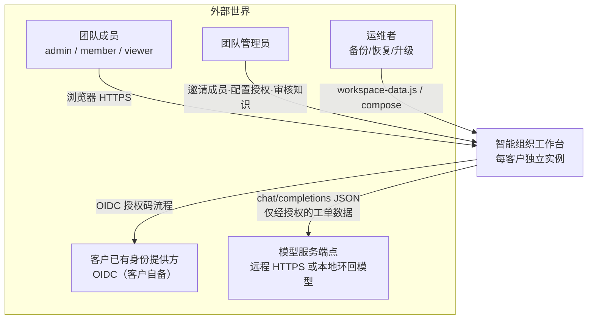
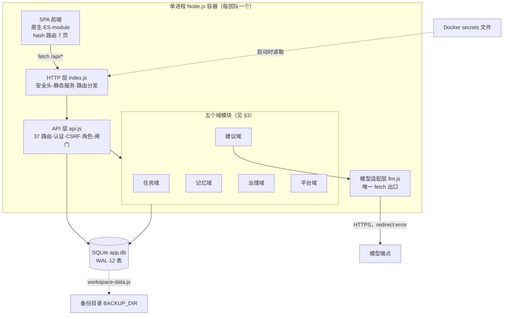
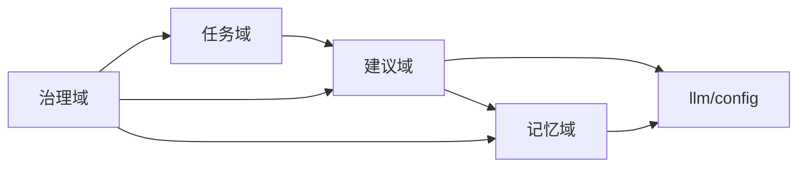
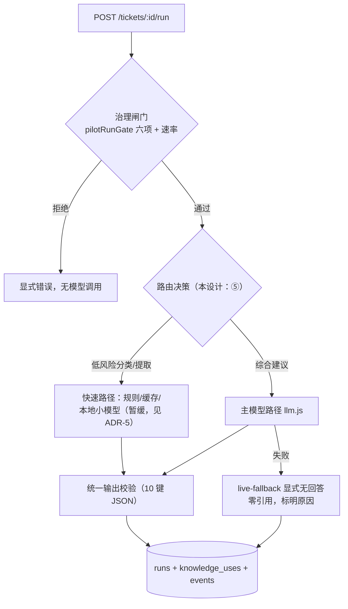
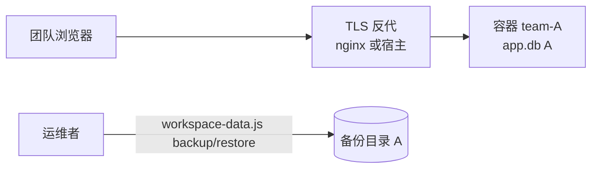
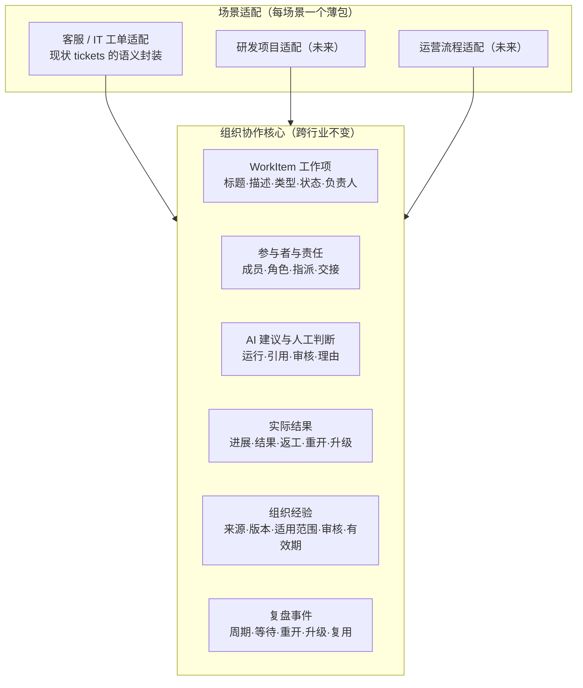
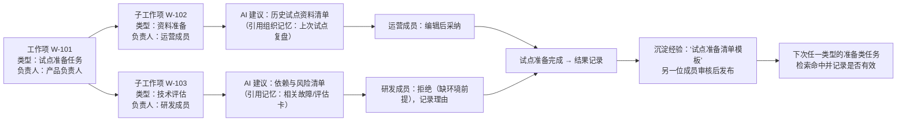

# ② 目标架构（Target Architecture）

- **日期：** 2026-11-20
- **状态：** 设计稿，待用户评审确认后进入实施
- **输入：** ①现状审计（research/architecture/01）、research/03 三层框架、research/06 产品定义、用户 7 项能力要求与 7 项架构原则
- **总原则：** 单团队试点优先；不为假想的规模提前引入分布式；每个演进步骤由 ⑦ADR 的触发条件驱动。
- **证据标记：** 沿用 ① 的分级。【已实现】= 当前代码已有；【本设计】= 本文新设计，代码未实现；【ADR-x】= 由对应决策文档背书。

---

## 0. 一句话目标形态

**一个单进程单体应用，内部按五个域划分模块边界（任务、建议、记忆、治理、平台），所有 AI 能力走同一条"授权→检索→生成→人工判断→结果回写"的受控管道；未来向多团队/多模型/向量检索的演进，全部通过替换管道中的接缝实现，而不是重构应用。**

---

## 1. C4 Context（系统上下文）

**文字说明（适用阶段：全部阶段）**
- 系统对外只有四个接触面：浏览器、OIDC IdP、模型端点、运维通道。**没有**邮件服务、消息队列服务、第三方 SaaS 集成、自助注册页。
- 模型端点是**唯一的外部数据出口**，且受 pilotRunGate 六项服务端检查约束【已实现】；除模型调用外系统不发起任何出站请求（typesafe 影子评估仅限样本数据且永不生效，未来若正式启用需新的 ADR）。
- 团队成员只通过浏览器交互；AI 不产生任何对外消息（不站内信、不邮件、不对客自动回复）——这是权限阶梯第 4 级（修改组织状态）保留给人类的直接体现。

---

## 2. C4 Container（容器视图）

**文字说明（适用阶段：单团队试点 → 多团队初期）**
- 容器内不分进程、不分服务。**域层是逻辑边界不是部署边界**：依赖方向单向（HTTP → API → 域 → store/llm），域之间通过 store 公开函数互访，禁止域内语句直接跨域查表。
- 前端无构建链，`UI_PROMPT_VERSION` 与服务端 `PROMPT_VERSION` 的一致性校验已在平台域加入启动断言（修复审计 R9，共享常量 `public/app-version.js`，不一致拒绝启动）【已实现 2026-11-20，P1】。
- 存储只有一个 SQLite 文件；**索引边界** = 主表 B-tree 索引（现有）+ 未来事件统计如变慢，用"汇总表 + 写入时更新"解决，而不是引入第二存储【本设计，触发条件见 ADR-6】。

---

## 3. 域划分与依赖方向（代码模块的重组地图）

目标架构把现有 24 个模块映射到五个域。**这是整理现有代码的方向，不是重写**——绝大多数模块已经天然落在某域内。

| 域 | 现有模块（全部已存在） | 域职责 | 缺口（本设计新增） |
|---|---|---|---|
| **任务域** | 工单 CRUD（store 部分）、状态机、交接（api.js handoff 路由）、draft-gate | **工作项（WorkItem）全生命周期**：状态转换合法性、指派、交接验证、结果记录；任务类型适配（§8、ADR-008） | 词表/类型层（§8：现状 tickets 表即 WorkItem，无独立类型概念） |
| **建议域** | agent.js、llm.js、demo-brain.js、live-fallback.js、retrieval.js（供记忆域调用）、draft-lineage.js | 生成 AI 建议：授权检查→上下文组装→模型调用→输出校验→落库 | **延迟分层**（⑤ 的快速/深度路径）、**运行记录补"采纳/有效"字段**（R1） |
| **记忆域** | knowledge-draft.js、store 卡片部分、data-scope.js、analytics 记忆统计 | 组织记忆的版本化生命周期：草稿→审核→发布→替代/停用；检索语料组装 | **采用/有效跟踪**（R1 主缺口）：knowledge_uses 增加 adopted/helpful 结果列（④ 详设） |
| **治理域** | auth.js、角色闸门、pilotRunGate、脱敏状态、review-source、事件、导出、反馈 | 身份、权限阶梯、模型发送授权、审计事件、数据边界 | 错误响应规范化（R4）；审计载荷字段规范（R5 成文） |
| **平台域** | config.js、db.js、index.js 启动、reset、workspace-data.js、compose/Dockerfile | 配置、存储引擎、启动/关闭、备份恢复、部署单元 | 多团队运维包（逐实例升级清单、配置漂移检查）（§6） |

**依赖规则（全部单向，域间不反向依赖）：**

- 建议域**通过记忆域的检索函数**取语料（`searchApprovedMemory`），不直接查 knowledge_cards 表。
- 治理域是唯一的"横切"域：所有写路由先过治理闸门再进业务域。
- 观察统计（analytics/batches/pilot-loop/team-learning）归入治理域的"观察"子层：只读、不写入、不参与业务判断——与产品写入路径物理同库但逻辑隔离（审计 R8 维持现状，拆分触发条件在 ADR-6）。

---

## 4. 关键架构边界（模型路由 / 智能体执行 / 人工审批）

### 4.1 模型路由边界

- 【已实现】唯一模型出口 llm.js；超时→ModelUnavailableError→显式失败占位；速率上限。
- 【已实现 2026-11-20，P4】路由决策函数 `routeRequest(ticket, kind)` 已落地建议域：返回 `{path: 'main'|'fast_cached', reason}`，fast_cached 仅含**确定性规则**（同题 + 来源工单已解决已审才命中），**本地小模型暂缓**——等主路径稳定且有真实延迟数据后再评估（ADR-5）。每条运行的 `runs.path` 字段已落库（demo 恒 main）。
- 【不变量】无论路径，输出都过同一 10 键校验；`model_authorized_*` 匹配检查只针对主模型路径的远程端点。

### 4.2 智能体执行边界

- 智能体 = **一个角色、三个受控工具**（search_approved_memory / prepare_handoff / draft_knowledge_card），全部只读或产草稿【已实现】。
- 【设计保留，实现条件化】工具清单以常量 + 白名单纪律固化在建议域（当前三工具已实现且经 event-kinds 白名单登记）；`AGENT_TOOLS` 独立常量在新增第一个工具时一并建立——现在只有一个智能体、三个工具，提前抽象违反「只在第二个实例存在时抽象」。新增工具仍须同时满足：服务端实现 + 权限阶梯评级 + 事件记录 kind（event-kinds.js 白名单），三者缺一不可上线。
- 不引入多智能体编排（框架、消息总线、自动委派）。v1 的"多角色"通过**同一管道的不同提示词/检索范围**实现，不通过多进程实现。

### 4.3 人工审批边界

权限阶梯与现状的映射（四级，research/03）：

| 级别 | 动作 | 执行者 | 现状 | 目标 |
|---|---|---|---|---|
| 1 建议 | 产出建议文本 | AI | 已实现 | 不变 |
| 2 准备 | 交接摘要、知识草稿 | AI 产草稿 | 已实现 | 不变 |
| 3 执行 | 对客回复、状态变更、分派 | 人类（服务端写路由） | 已实现（AI 无通道） | 不变；**永远不给 AI 第 3 级通道**（除非新 ADR + 团队明确授权） |
| 4 组织状态 | 知识发布/停用、成员邀请、模型授权登记 | 人类 admin/member | 已实现 | 不变 |

- 【已实现 2026-11-20，P1】**服务端不变量断言**：任何 AI actor（`agent:*`）的写请求在 api.js 分发层直接拒绝（`x-actor` 头 + PATCH body.actor 双拦截，403 + `agent_write_rejected` 审计事件，smoke 断言覆盖）。权限阶梯已从约定变成代码。

---

## 5. 存储与索引边界

| 数据类别 | 位置 | 性质 | 变更方式 |
|---|---|---|---|
| 事实记录 | tickets/runs/reviews/knowledge_cards/card_reviews/knowledge_uses/members/auth_sessions/events | 追加为主，状态列变更 | 预编译语句；关键写动作同步 addEvent |
| 派生统计 | metrics（实时查询）/ team-learning（事件 json_extract）/ batches 视图 | 可随时重算 | 只读查询层（analytics），不落表；量大后转汇总表（触发条件 ADR-6） |
| 临时缓存 | 无（v1 明确不引入） | — | 未来若加（如检索语料缓存），必须带 TTL + 写失效，且缓存可全量重建 |

- 【已实现 2026-11-20，P2；smoke 42/0】knowledge_uses 增列方案（R1 修复的数据基础，④§6 详设）：`adopted`(该运行的权威审核为 adopt/edit)、`helpful`(成员三态手工标注) 分开记录；**命中≠采用≠有效** 三层互不推断（helpfulRate 分母只算已标注）。
- 索引：现有 idx_* 保留；新增外键列（superseded_by_card_id、adopted 相关）按 ④ 的索引清单补。

---

## 6. 部署拓扑：单团队 → 多团队

### 阶段 A：单团队试点（当前）

每团队 = 1 个 compose 项目 + 1 个数据卷 + 1 个独立 env 文件 + 1 个端口。**数据库、备份、模型密钥、OIDC 配置全部物理隔离**。【已实现，本机多实例并存验证过（4173/4182/4186/4192/4193/4195）】

### 阶段 B：多团队（同一宿主 N 个实例）

- 不改应用架构，只加运维层：【部分已实现（P5，2026-11-20）——`deploy/UPGRADE.md` 含多实例逐台升级清单模板与漂移检查命令；实例清单文件 + 一键脚本推迟到真实第二个实例出现时（避免无实例的清单）】
  - 实例清单文件（每实例：端口、DATA_DIR、镜像 tag、备份路径），一键升级脚本按清单逐实例执行（停止→备份→替换镜像→健康检查→下一台）。
  - 配置漂移检查：对比清单与实际容器 env（APP_MODE 必须为 product、HOST 绑定 127.0.0.1 等）。
  - 每实例独立模型密钥与授权登记——沿用现有 per-workspace 授权模型，无跨租户任何共享。
- 明确不做：共享数据库多租户（行级 tenant_id）、共享模型网关、跨团队检索。触发重新评估的条件在 ADR-7。

### 阶段 C（远期，条件触发才启动）

分布式拆分（独立队列、独立检索服务、多存储）——**触发条件写在 ADR-6/ADR-7**：并发持续超过单进程承载、检索语料超过 BM25 性能包络、或出现跨团队产品形态。阶段 C 前一切演进通过接缝完成。

---

## 7. 目标架构对 7 项产品能力的覆盖表

| 产品能力 | 架构落点 | 状态 |
|---|---|---|
| 1 任务级人机职责分配 | 任务域状态机 + 权限阶梯（§4.3）+ runs.created_by；任务概念以通用 WorkItem 为根（§8），工单是首个场景适配 | 已实现+断言加固；类型层待演进（ADR-008） |
| 2 带来源/适用条件/不确定点的 AI 建议 | 10 键输出（citations/uncertainties）+ 来源分级（policy/guide 权威 vs case 参考） | 已实现 |
| 3 成员评判/修改/拒绝/升级 | reviews 表（adopt/edit/reject + 理由）+ escalated 状态 + 最新审核权威 | 已实现 |
| 4 记录执行/进展/交接/结果 | outcome_note + 交接事件对 + 状态机 | 已实现 |
| 5 已评审经验→治理下的组织记忆 | 卡片生命周期 + scope/有效期/审核 + fail-closed 检索 | 已实现 |
| 6 后续任务找经验+记录实际使用 | 检索（自排除/scope）+ knowledge_uses | **部分**：命中已记，采用/有效缺失 → R1 主修复项 |
| 7 按结果更新知识/流程/AI 权限 | 卡片版本替代/停用 + model_authorized 目标绑定 | 部分：替代/停用已有；"按结果自动提示更新"未实现（记忆域新组件，路线图 P2） |

**结论：** 目标架构不需要推翻任何现有机制；三个新组件（路由决策、采用/有效跟踪、服务端 AI 写断言）+ 两个加固（错误规范化、版本一致性断言）即可覆盖全部 7 项能力。所有新组件都落在现有域内，不引入新运行时。**领域边界修正（2026-11-20 用户确认）：产品核心面向通用组织协作，客服/IT 支持是暂定验证场景而非领域模型——新增 §8 核心/适配分层与 ADR-008。**

---

## 8. 领域边界：通用协作核心 + 场景适配层（2026-11-20 修正新增）

### 8.1 分层原则

**判定规则（哪些属于哪层）：**

| 归属 | 判定 | 例子 |
|---|---|---|
| 核心层 | 换一个行业/场景仍然成立的概念与流程 | 工作项、负责人、交接、AI 建议带来源、人工采纳/拒绝、结果记录、经验版本治理、复用与有效性、审计 |
| 适配层 | 只因客服/IT 场景而存在的字段、术语、规则 | category 的 IT 类别枚举、urgency 的"紧急/高/中"、`resolved_case` 语义（"已解决案例"是客服说法，通用概念是"已完成工作项的经验来源"）、工单对客回复语境 |
| 核心层（机制）+ 适配层（取值） | 机制通用、枚举值场景化 | 状态机结构（open→in_progress→done→reopened/escalated）是核心；具体状态词表可由适配层声明 |

**明确不做（v1，用户确认）：** 任意行业可视化流程搭建器、插件市场、自定义字段引擎。适配层是**代码内的薄包**（类型描述对象 + 词表 + 表单片段），不是运行时用户可配置系统。

### 8.2 现状代码的领域解读（渐进演进的起点）

现状 `tickets` 表与工单状态机，**按结构看已经是 WorkItem**（标题/描述/负责人/状态/结果/交接），只是：概念名（ticket）、状态词表（客服语义）、category/urgency 枚举、检索里的 resolved_case 术语，都带着客服烙印；且全系统没有"类型"概念——不知道哪些部分是核心、哪些是场景。

因此演进策略是**重命名式收敛，不是重建**：

| 步骤 | 变更 | 破坏性 | 说明 |
|---|---|---|---|
| E1 | 代码/文档层面引入 `work_item` 概念命名：任务域模块与函数改用 workItem 语义（DB 列名、表名、API 路径**保持不变**，避免破坏前端与数据） | 零 | 纯重命名/注释/文档；`GET /api/tickets` 仍是有效路径，内部理解为 workItem 列表的客服适配 |
| E2 | 引入 `work_item_types` 描述对象（代码常量或小表）：每个类型声明 {状态词表, 类别枚举, 紧急度枚举, 表单字段, 术语标签}；`support_ticket` 为第一个类型，现库全部行归属它 | 低（幂等加列/加表） | 工单创建时写 `work_item_type='support_ticket'`；旧数据迁移回填同一类型 |
| E3 | API 层增加通用路由 `/api/work-items`（读模型聚合 tickets；写路径仍走现有路由直至前端切换），UI 术语按类型渲染 | 低 | 新旧路由并存一个阶段，验收后旧路由标记 deprecated（不删除） |
| E4 | 第二种类型（如"新产品试点准备"任务）以新类型描述对象接入：复用同一 store/审核/记忆/交接机制，仅新增词表与表单 | 低 | 这是"新增第二种任务类型不复制整套系统"的验收点 |
| E5（远期） | 若多类型稳定，再评估表结构归并（tickets→work_items 统一表）——**仅当 E4 实证复用成功且迁移工具就绪后**，否则保持现状表名 | 中 | 触发条件见 ADR-008 |

**核心机制确认不可下放给适配层：** 权限阶梯、审核权威规则、交接验证、scope/有效期 fail-closed、审计事件、采用/有效跟踪——全部只实现一次，所有类型共享。适配层只能声明词表与展示，不能改变这些语义。

### 8.3 跨职能虚构任务示例：「新产品试点准备」

用同一核心机制支撑不同职责的人与 AI 协作（v1 文档示例，非已实现功能）：

该示例说明：工作项可以有层级/关联（现状 tickets 无子项概念——这是 WorkItem 模型新增的最小结构，见 ④§10）；不同参与者按各自角色判断同一条 AI 建议；经验沉淀后跨**任务类型**复用——这正是"客服工单不成为根模型"的价值：沉淀于一次试点准备的经验，能被未来的技术评估任务检索到。

### 8.4 评审必答四问（用户提出，逐条落位）

| 问题 | 回答落点 |
|---|---|
| 哪些实体和流程适用于各种组织？ | §8.1 核心层清单 + §3 五域（除词表枚举外全部机制） |
| 哪些字段/规则只属于客服/IT？ | §8.1 判定表 + ④§10 的字段归属标注（category/urgency 词表、resolved_case 术语、对客回复语境） |
| 新增第二种任务类型时如何避免复制整套系统？ | §8.2 E4：类型 = 描述对象（词表+表单），机制单实现共享；④§10 的 type 列 + 适配描述对象；验收 = 「新产品试点准备」示例全流程走通且零新表复制 |
| 如何避免通用化导致模型无法理解？ | 三条硬约束：①不引入自定义字段引擎（字段固定、值受 CHECK 约束）；②类型描述对象用中文术语声明、UI 按类型渲染，用户永远看到"工单/试点准备"等具体词而非"WorkItem #123"；③核心/适配边界以"换行业还成立吗"一问判定（§8.1 表），边界模糊时保持现状具体命名——抽象只到有第二个实例为止 |

