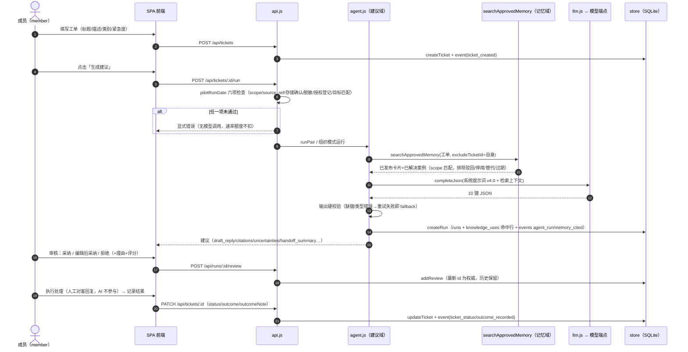
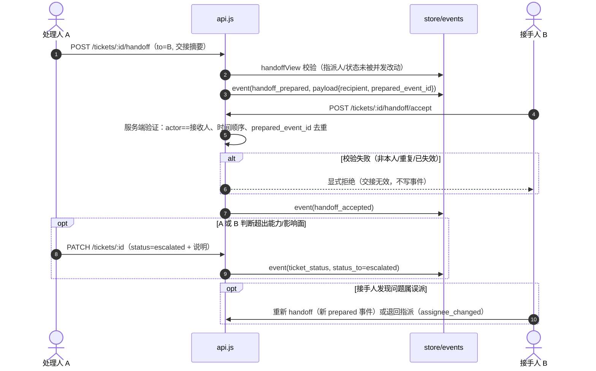
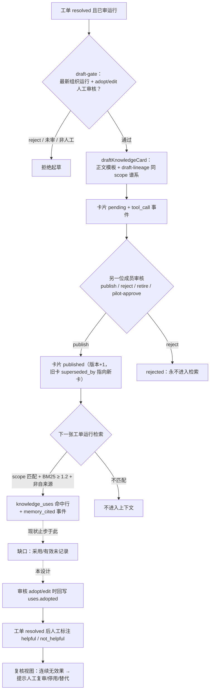
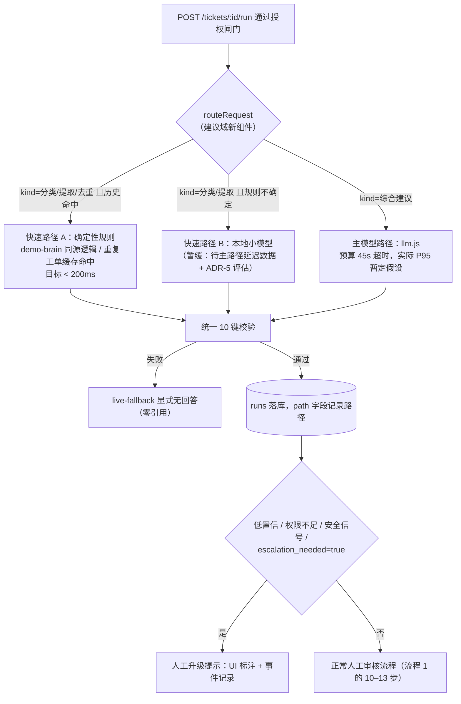
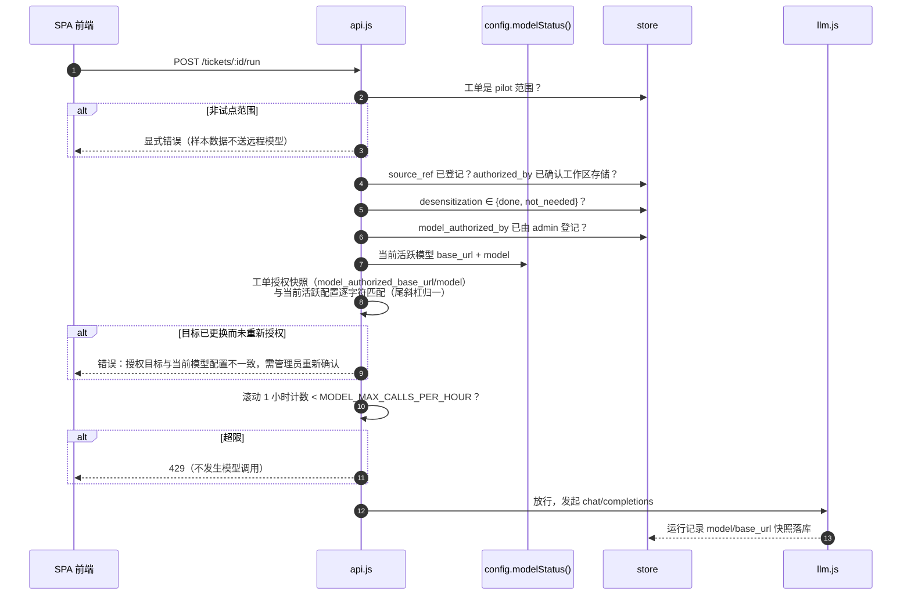
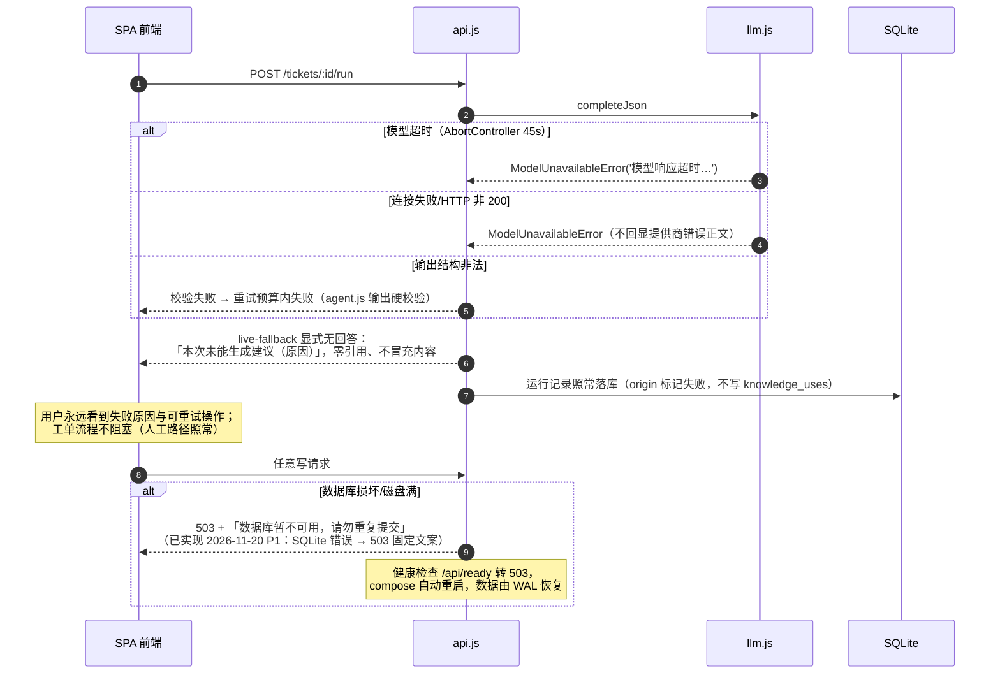
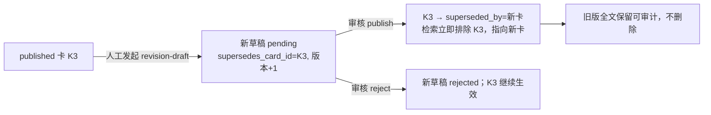
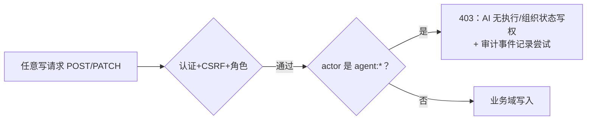
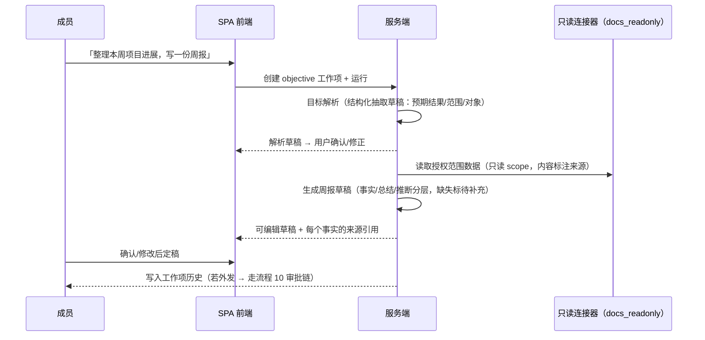
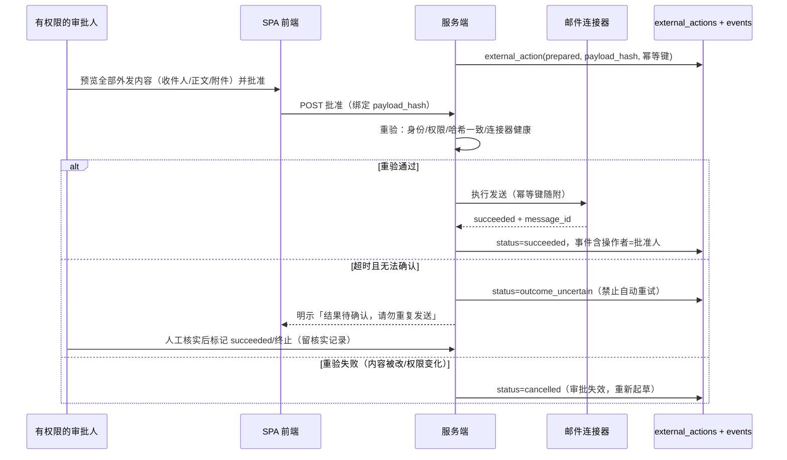

# ③ 核心流程图与时序图（Flows & Sequences）

- **日期：** 2026-11-20
- **状态：** 设计稿；每张图标注【现状：已实现 / 本设计：新增 / 两者混合】
- **约定：** 时序图中的参与者均为真实代码模块或明确规划的组件；不虚构不存在的服务。

---

## 流程 1：任务 → AI 建议 → 人工判断 → 执行 → 结果（主闭环）

【现状：已实现（smoke.js 全程验证过【本机】）】

**边界声明：** 步骤 10–13 之间，AI 对客回复永远不发生；`draft_reply` 只是建议文本，采纳记录在 reviews，真实回复由成员在工单外完成并回填结果。【现状：代码强制】

---

## 流程 2：交接 / 接收 / 退回 / 升级

【现状：已实现（prepare/accept 路由 + team-learning.js 验证规则）】

**有效性规则（防"纸面交接"）：** team-learning.js 只统计同时满足 actor==接收者、acceptedAt ≥ preparedAt、prepared_event_id 未重复的交接；等待时长 = accept − prepare。【现状：代码】

---

## 流程 3：经验草稿 → 审核 → 发布 → 后续检索采用 → 结果反馈

【现状：前半已实现；"结果反馈"环节 = 本设计（R1 主修复）】

**文字说明（适用阶段：试点即生效）**
- 命中/采用/有效三层互不推断：`hit`（进入上下文）≠ `adopted`（权威审核采纳了引用此卡的建议，回写 use 行）≠ `helpful`（成员三态标注确认有帮助）。【已实现 2026-11-20，P2：④§6 的 knowledge_uses 增列方案，smoke 42/0】
- 复核触发是**提示**不是自动动作：停用/替代永远由人工执行（权限阶梯第 4 级）。
- 过期知识（valid_until 过期、fail-closed）不出现在任何检索结果，但保留在库中可审计。【现状：analytics L165】

---

## 流程 4：延迟分层路径（快速路径 / 本地模型 / 主模型 / 人工升级）

【已实现（主模型路径 + 错误规范化）；路由决策与快路径已实现（P4，⑤ 详设，demo 恒 main）；本地小模型暂缓（ADR-5）】

**对比表（决策依据，数字均为暂定假设，无实测；①审计 R2/R3 是动机）：**

| 路径 | 端到端延迟 | 单次成本 | 失败率 | 数据暴露 | 质量 |
|---|---|---|---|---|---|
| 串行（现状） | 模型总时长（实测值待采） | 全额 | 超时即失败 | 全文送远程 | 基准 |
| demo 并行对（现状） | max(两模型) | 2× | 单边失败仍出另一边 | 2× | 对照观察用 |
| 快速路径（规则） | &lt;200ms（暂定） | 0 | 极低 | 不出本地 | 仅限窄任务 |
| 本地小模型（暂缓） | 秒级（暂定） | 低 | 需降级预案 | 不出本地 | 分类/提取可用 |
| 人工升级 | 人工时长 | 0 | 0 | 不出本地 | 最高 |

**规则：** 快速路径的输出与主模型输出**同构同校验**；`runs.path` 记录选择原因；快速路径永不处理 escalation 或涉及授权边界的工单。

---

## 流程 5：模型调用前的数据授权与目标校验（pilotRunGate 时序）

【现状：已实现，api.js pilotRunGate】

**关键不变量：** 「存储授权」与「发送授权」是两次独立确认（工单上分别有 authorized_by 与 model_authorized_by 字段）；换模型端点 = 全部旧授权失效，必须重新人工确认。【现状：代码 + 迁移列】

---

## 流程 6：模型或数据库失败时的用户可见行为

【现状：模型失败路径已实现；数据库失败语义 = 本设计明确化】

**边界声明：** 模型失败时**绝不降级为演示生成器**（product 模式无 demo 回退，config.modelStatus 明文）；demo-brain 只属于 demo 模式。数据库失败时模型调用自然失败（无写库即无记录），不产生"看不到结果但模型已扣费"的静默损失——运行记录与模型调用在同一请求内完成，失败则两者都不可见。【现状代码 + 本设计错误码规范】

---

## 流程 7（补充）：知识卡片版本替代

【现状：已实现（store.js L421–575 createCardRevision/setSupersededBy）】

**文字说明：** 替代是"指针翻转"而非删除：旧卡状态变 superseded、superseded_by_card_id 指向新卡，检索条件 `status='published' AND superseded_by_card_id IS NULL` 自动排除；全部历史版本与 card_reviews 保留。【现状：代码】

---

## 流程 8（补充）：AI actor 写请求的服务端断言（已实现，P1）

【已实现 2026-11-20：把权限阶梯从约定升级为代码——分发层 x-actor 头 + PATCH body.actor 双拦截，smoke 断言「AI 身份写请求被拒（403）」通过】

**文字说明：** 现状 AI 只通过内部函数（agent.js 直接调 store）写 runs/events，不经过 HTTP；该断言保证未来任何误配置（如把模型响应直通某写路由）会在分发层被拦截并留下审计痕迹。**已实现（2026-11-20，P1）：api.js 分发层 x-actor 头检查 + PATCH body.actor 拦截 + `agent_write_rejected` 审计事件；smoke 断言「AI 身份写请求被拒（403）」通过（42/0）。**

---

## 流程 9（执行域）：自然语言目标 → 周报草稿（⑨§6.1，P7 启用）

## 流程 10（执行域）：邮件草稿 → 人工审批 → 连接器发送 → 结果记录（⑨§6.2，P7 启用）

---

## 附：流程与总纲映射

| 总纲§十一.3 要求 | 本文档流程 |
|---|---|
| 用户请求→Agent 规划→读取授权资料→起草周报 | 流程 9 |
| 邮件草稿→人工审批→连接器发送→记录结果 | 流程 10 |
| 组织知识审核→后续任务复用→结果反馈 | 流程 3 |
| 模型/连接器/队列失败时的恢复与人工接管 | 流程 6（模型/库）+ 流程 10 的 outcome_uncertain 分支（连接器）+ ⑨§7（断连/取消） |
