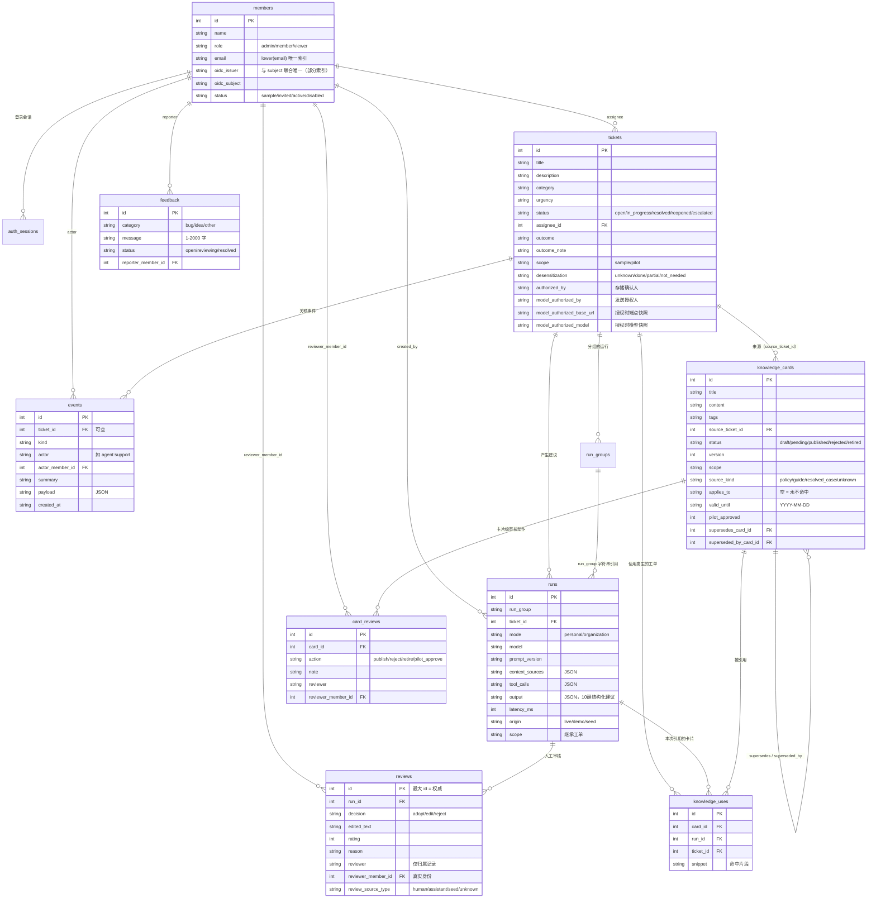
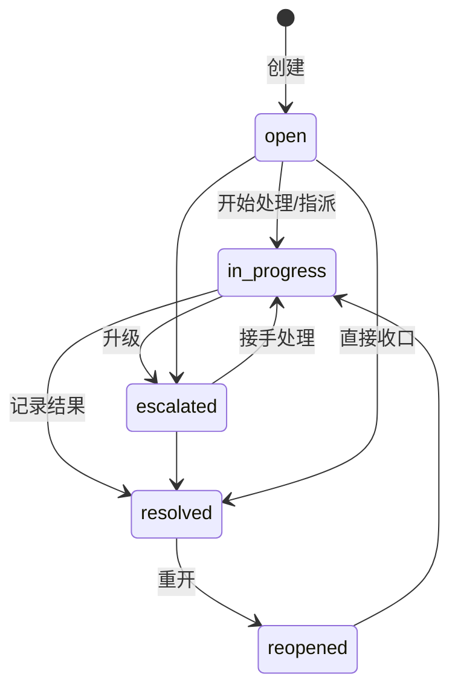
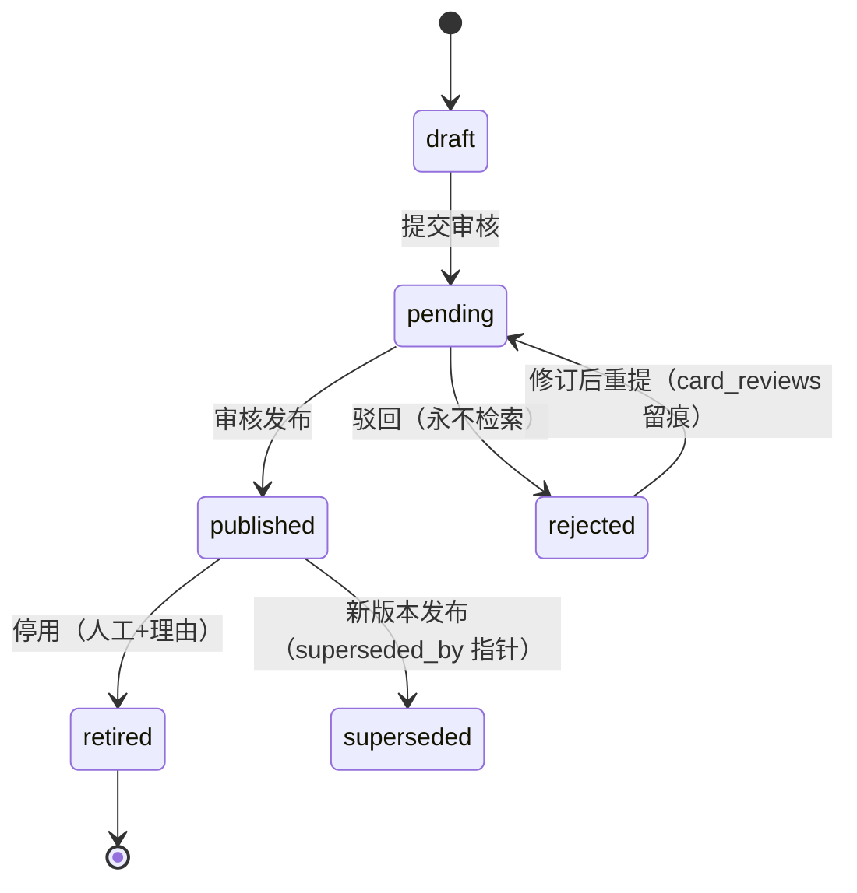

# ④ 数据与 API 设计（Data & API Design）

- **日期：** 2026-11-20
- **状态：** 设计稿。§1–§5 描述现状（已实现，附证据）；§6–§9 为本设计新增/变更（待评审后实施）。
- **原则：** 事实记录、派生统计、临时缓存三类数据分开；AI 建议 ≠ 真实结果；手填姓名 ≠ 身份认证。

---

## 1. 实体关系图（现状，13 张表全部来自 db.js SCHEMA）



**表清单：** 13 张表（members、workspace_profile、auth_sessions、oidc_login_flows、tickets、run_groups、runs、reviews、knowledge_cards、card_reviews、knowledge_uses、events、feedback；feedback 在 db.js L162–172，含独立路由）。

---

## 2. 状态机

### 2.1 工单状态（TICKET_STATUS）



【现状：状态集合与转换由 store.updateTicket 控制 + 事件 kind=ticket_status 记录 status_to；非法转换（如 resolved→open 直改）在 UI 层受限，服务端按传入状态写入并留审计。本设计细化：④§6.1 服务端加转换白名单。】

### 2.2 知识卡片状态（CARD_STATUS）



【现状：draft→pending→published/rejected/retired 由 reviewCard/retireCard/版本工作流实现（cardRevisionWorkflow:1）；superseded 是派生态（status 仍为 published 但 superseded_by_card_id 非空 → 检索排除）。】

### 2.3 运行审核权威

同一 run 的多条 reviews 全部保留；**权威 = 最大 id**。语义：后一次审核覆盖前一次（改判留痕）。review_source_type 从不从 reviewer 姓名推断（迁移回填规则：'Codex（助手代审）'→assistant；origin=demo→seed；其余 unknown）。【现状】

---

## 3. 事件格式与审计原则

### 3.1 事件类型清单（现状全部 kind，UI KIND_LABEL 与之对齐）

| kind | actor | payload 关键字段 | 触发点 |
|---|---|---|---|
| ticket_created | system:seed / member | — | createTicket |
| ticket_status | 操作者 | status_to | updateTicket |
| assignee_changed | 操作者 | — | updateTicket |
| outcome_recorded | 成员 | — | updateTicket(结果) |
| agent_run | agent:org-mode / agent:personal-mode | runId, model, latencyMs, origin | createRun |
| memory_cited | agent:org-mode | cardId, runId, score | createRun（每张命中卡） |
| model_call_requested | — | — | 模型调用前 |
| review_submitted | 成员 | — | addReview（含来源） |
| handoff_prepared / handoff_accepted | 成员 | recipient, prepared_event_id | 交接 |
| card_drafted / card_draft_edited / card_revision_drafted | agent / 成员 | cardId | 草稿流程 |
| card_published / card_rejected / card_retired / card_pilot_approved | 成员 | cardId | reviewCard/retireCard |
| comparison_ready | agent | — | 仅 demo 配对 |
| ticket_model_authorization_changed | admin | previousTarget / target（模型+端点） | 授权变更 |
| workspace_name_changed / workspace_exported | admin | — | 治理动作 |
| feedback_submitted / feedback_status_changed | 成员 | — | 反馈 |
| tool_call | agent | cardId 等 | 受控工具调用 |
| seed_loaded | system | — | 首启演示数据 |

### 3.2 审计原则（现状已执行 + 本设计成文）

1. 事件只追加，不更新不删除（无 UPDATE/DELETE 语句触及 events 表）。【现状】
2. payload 存 **id 与元数据，不存工单正文**（现状核查：所有 payload 均为 id/计数/状态字符串/模型名）。【现状】
3. 【已实现 2026-11-20，P1】payload 白名单成文：全部 28 个 kind 的白名单字段集中在 `server/event-kinds.js`；描述性文本只能进 summary，summary 由服务端模板生成，不复制用户输入全文；白名单外字段在写入点抛错。
4. 【已实现 2026-11-20，P1】kind 常量收敛到 `server/event-kinds.js` 单一导出（`EVENT_KINDS`/`EVENT_KIND_LABEL`），UI 标签表经 `/api/state.eventKinds` 做运行期一致性对账（不一致 console.warn）。

---

## 4. API 边界与契约（现状 37 路由 + 本设计变更）

### 4.1 路由总表（现状，api.js L182–730）

| 组 | 方法+路径 | 权限 | 说明 |
|---|---|---|---|
| 健康 | GET /api/health、/api/ready | public | ready 检查库+模型配置（注明配置≠可达） |
| 会话 | GET /api/state、GET/PATCH /api/auth/*、POST /api/auth/logout | 见 auth.js | product 需登录；logout 需 CSRF |
| 任务 | GET/POST /api/tickets、GET/PATCH /api/tickets/:id | 登录（viewer 只读） | PATCH 含状态/指派/结果 |
| 授权 | PATCH /api/tickets/:id/model-authorization | admin | 登记/撤销发送授权 |
| 建议 | POST /api/tickets/:id/run | member+ | pilotRunGate 六项 |
| 审核 | POST /api/runs/:id/review | member+（REVIEWER_REQUIRED） | adopt/edit/reject |
| 交接 | POST /api/tickets/:id/handoff、/handoff/accept | member+ | 服务端验证规则 |
| 记忆 | GET /api/memory、POST /api/memory/search、POST /api/cards/:id/{revision-draft,draft-edit,review,retire,pilot-approve} | member+；CARD_EDITOR_REQUIRED | 卡片全生命周期 |
| 沉淀 | POST /api/tickets/:id/knowledge-draft | member+ | draft-gate |
| 观测 | GET /api/metrics、/api/events、/api/observation[/:batch]、/api/pilot-loop、/api/team-learning | 登录（只读） | team-learning 仅 product |
| 治理 | PATCH /api/admin/workspace-profile、POST /api/admin/{model-check,export,reset}、GET/PATCH /api/members[...] | adminOnly | reset 仅 demo |
| 反馈 | POST/GET /api/feedback、GET/PATCH /api/admin/feedback[/:id] | 登录 / admin | |

**契约约定（现状已执行）：** 全 JSON；错误统一 `{error: "中文可读信息"}`；CSRF 覆盖非 GET；请求体 ≤1MB；viewer 拦截在业务处理前。

### 4.2 本设计：错误响应规范（修复审计 R4）

| 场景 | 现状 | 目标 |
|---|---|---|
| 业务校验失败 | 400 + 中文信息 | 不变 |
| 未授权 | 401/403 | 不变 |
| 内部异常 | **500 + err.message 回显** | 500 + 固定文案「服务器内部错误，已记录」+ `errorId`（时间戳+随机）；err.message 只进服务端日志。errorId 供用户报告、与日志对账 |
| 数据库不可用 | 未专门处理 | 503「数据库暂不可用，请勿重复提交」 |

### 4.3 本设计：幂等与并发

| 操作 | 风险 | 方案 |
|---|---|---|
| POST /tickets/:id/run | 双击重复调用模型（双倍费用） | 【已实现 2026-11-20，P1】运行去重：同工单 90s 内已有运行（以 runs 表最新 created_at 为准）→ 409 RUN_DUPLICATED；smoke 断言覆盖。幂等键升级属 external_actions（§11，P7） |
| POST review | 重复提交产生两条权威竞争 | 无需修：最大 id 权威语义已定义改判留痕 |
| PATCH ticket | 并发改状态/指派 | 【已实现 2026-11-20，P1】updated_at 乐观校验（前端带回 seen updatedAt，不一致 409 STALE_WRITE + latestUpdatedAt；store 层 UPDATE...WHERE updated_at=? 双重守卫，smoke 断言通过）——先做交接（handoffView 已有失效检查），工单级已补 |
| 卡片 publish/retire | 状态机重复迁移 | 现状已有前置检查（仅 pending 可 review、仅 published 可 retire）【现状】 |

---

## 5. 检索同步与过滤（现状机制，④明确边界）

- **无独立索引**：检索语料 = 查询时实时从 SQLite 读取 published 卡片+resolved 案例，经 `cardMatchesScope` + 过期过滤 + 自排除后进入 BM25 评分。【现状：retrieval.js/analytics.js】
- **一致性**：单写者（同一进程内先写库后查语料，SQLite 同事务可见性）→ 无同步延迟问题。【现状推论】
- **本设计边界承诺**：引入任何缓存/向量索引时必须同时实现：(a) 写入路径上的失效钩子（publish/retire/supersede/expire 时失效）；(b) 全量重建命令（缓存可丢弃重建）；(c) 一致性冒烟断言（发布后立即可检索、停用后立即不可检索——并入 scripts/smoke.js）。

---

## 6. 本设计：采用/有效跟踪（R1 主修复的数据设计）

### 6.1 knowledge_uses 增列

```sql
-- 迁移（幂等 ALTER TABLE ... ADD COLUMN）：
ALTER TABLE knowledge_uses ADD COLUMN adopted INTEGER NOT NULL DEFAULT 0;
  -- 该 use 对应 run 的权威审核为 adopt/edit 时置 1（审核提交时回写）
ALTER TABLE knowledge_uses ADD COLUMN adopted_review_id INTEGER REFERENCES reviews(id);
  -- 回写来源审核，可追溯
ALTER TABLE knowledge_uses ADD COLUMN helpful INTEGER;  -- NULL=未标注 / 1=有帮助 / 0=无帮助
ALTER TABLE knowledge_uses ADD COLUMN helpful_note TEXT NOT NULL DEFAULT '';
ALTER TABLE knowledge_uses ADD COLUMN helpful_by_member_id INTEGER REFERENCES members(id);
ALTER TABLE knowledge_uses ADD COLUMN helpful_recorded_at TEXT;
CREATE INDEX IF NOT EXISTS idx_uses_card_adopted ON knowledge_uses(card_id, adopted);
```

**写入规则（服务端强制，三层互不推断）：**

| 层 | 字段 | 写入时机 | 语义 |
|---|---|---|---|
| 命中 | （行存在） | createRun | 卡片进入上下文 |
| 采用 | adopted=1 | 权威审核为 adopt/edit 时（addReview 内同步回写该 run 的全部 use 行） | 人工采纳了引用此卡的建议；**reject 不回写、不删除已写行**（改判：新权威审核覆盖 adopted 值） |
| 有效 | helpful ∈ {0,1,NULL} | 工单 resolved（或 reopened）后，成员在工单详情页对该次引用显式标注 | 人对"这条经验是否真帮到了处理"的判断；NULL 是合法状态，不默认 1 |

**防污染规则：** helpful 只能由登录成员写入（带 helpful_by_member_id）；AI/seed 工单（scope=sample）同样可标注但统计分桶展示，试点结论只统计 pilot。API：`POST /api/uses/:id/helpfulness`（member+，body: {helpful, note}）+ 事件 kind=`use_helpfulness_recorded`。

### 6.2 派生视图（只读，不落表）

- 卡片详情：`hitCount / adoptedCount / helpfulCount / helpfulRate`（分母=adopted，避免"命中分母失真"）。
- 复核提示（记忆域新组件，只读计算）：published 卡若近 N 次（暂定 N=5，**暂定假设**）采用中 helpful=0 占比 ≥ 阈值（暂定 60%），在 UI 标「建议人工复审」——只提示，不自动停用。

---

## 7. 本设计：runs 路径与成本记录

```sql
ALTER TABLE runs ADD COLUMN path TEXT NOT NULL DEFAULT 'main';   -- main / fast_rule / fast_local / fallback_no_answer
ALTER TABLE runs ADD COLUMN path_reason TEXT NOT NULL DEFAULT '';-- 路由原因（短文本）
ALTER TABLE runs ADD COLUMN prompt_tokens INTEGER;                -- 回填（响应 usage 字段可用时）
ALTER TABLE runs ADD COLUMN completion_tokens INTEGER;
```

metrics 的"单任务调用/token/成本"从这两列派生；成本换算表放配置（每 token 单价是外部事实，不硬编码）。

---

## 8. 迁移与数据边界

- **迁移机制沿用现状**：幂等 ALTER TABLE + 启动时执行（migrateMemberAuth/migrateCardRevisions/migrateDataScopes 先例）；产品库迁移前有 readOnly 预检。【现状】
- §6/§7 的增列全部是**可回退的加列**（旧代码忽略新列），不重写表——回退 = 部署旧镜像即可运行。
- **删除/导出边界**（现状已实现，明文列出）：workspace-data.js export 全表导出（含 card_reviews/knowledge_uses）；erase 需服务停止+确认词；无行级删除接口（删除工单/卡片走状态而非物理删除——审计链永不破坏）。
- sample/pilot 数据边界：迁移回填保守（旧数据一律 sample/unknown），fail-closed；试点检索只取 pilot 卡。【现状】

---

## 9. 三类数据对照表（评审用）

| 类别 | 表/来源 | 变更方式 | 可否丢弃 |
|---|---|---|---|
| 事实记录 | tickets/runs/reviews/knowledge_cards/card_reviews/knowledge_uses/events/members/feedback | 仅服务端预编译语句+事件 | 否（审计链） |
| 派生统计 | metrics、team-learning、batches、pilot-loop 视图 | 实时查询重算 | 是（随时可重建） |
| 临时缓存 | v1 无 | — | 是 |
| AI 建议 | runs.output | 仅运行时写入，人工修改记录在 reviews.edited_text | 否（但永不当作真实结果展示） |

---

## 10. 本设计：通用 WorkItem 数据模型（领域边界修正，ADR-008 落地）

> 原则：**tickets 表就是 WorkItem 的事实表**（结构已是通用工作项），演进走"概念重命名 + 类型层"，不重建表、不迁移破坏性数据（§8.2 E1–E5）。本节定义最小数据变更；字段归属按"换行业还成立吗"划分。

### 10.1 最小数据变更（全部幂等加列/加表，可回退）

```sql
-- E2：工作项类型层（代码常量起步即可，入库为小表以便适配层自描述）
CREATE TABLE IF NOT EXISTS work_item_types (
  id TEXT PRIMARY KEY,                -- 'support_ticket' / 'pilot_prep' / ...
  label TEXT NOT NULL,                -- 中文显示名：'客服工单' / '试点准备任务'
  status_vocab TEXT NOT NULL,         -- JSON：该类型的状态词表（核心结构固定，词表类型化）
  field_vocab TEXT NOT NULL,          -- JSON：类别/紧急度等枚举词表
  created_at TEXT NOT NULL
);
-- tickets 加列：
ALTER TABLE tickets ADD COLUMN work_item_type TEXT NOT NULL DEFAULT 'support_ticket'
  REFERENCES work_item_types(id);
-- E4（第二种类型出现时的最小结构）：
ALTER TABLE tickets ADD COLUMN parent_ticket_id INTEGER REFERENCES tickets(id);
  -- 子工作项/关联；NULL = 顶层（现库全部为顶层，零语义变化）
```

**词表与 CHECK 的关系：** 现状 tickets 的 `status CHECK ('open','in_progress','resolved','reopened','escalated')` **保持不动**（它就是 support_ticket 类型的词表固化）；第二种类型若词表不同，不修改同一 CHECK——用"status 存类型词表值 + 服务端按类型校验"过渡，仅当 E5（表归并）触发时才评估 CHECK 重构。这避免"加一个类型就要改表约束"的复制式成本。

### 10.2 字段归属标注（评审四问之二）

| tickets 字段 | 归属 | 说明 |
|---|---|---|
| id / title / description / status / assignee_id / created_at / updated_at / scope | **核心** | 任何组织的工作项都成立 |
| source_ref / desensitization / authorized_by / model_authorized_* | **核心** | 模型发送授权与数据边界是产品级机制，非客服专属 |
| outcome / outcome_note / resolved_at | **核心（结构）+ 适配（语义）** | 结构通用；"resolved"一词属于客服语境，通用语义 = "已完成"（类型词表负责显示名） |
| category / urgency | **适配** | 词表（IT 类别、"紧急/高/中"）是 support_ticket 专属 → 移入 work_item_types.field_vocab |
| 交接 / 升级（escalated） | **核心（机制）/ 适配（词表）** | 交接验证规则、升级状态转换是核心；"升级到 IT 值班"等显示语是适配 |

runs/reviews/knowledge_cards/knowledge_uses/events：**全部核心**，但知识卡的 `source_kind='resolved_case'` 显示名（"已解决案例"）由适配层渲染为通用"已完成工作项的经验"；检索机制不变。

### 10.3 API 与前端演进（对应 ②§8.2 E3）

- 新增 `GET /api/work-items`（读模型：SELECT * FROM tickets WHERE work_item_type = ?，聚合 runs/reviews 摘要）；写路径继续使用现有 `/api/tickets` 路由直至前端切换完成——**新旧路由并存，零破坏**。
- UI 术语渲染：`类型描述对象.label` 与词表决定页面用"工单"还是"试点准备任务"；核心实体在代码/文档中统一称 WorkItem（E1 重命名，不改 API/DB 名）。
- 事件补充：kind=`work_item_type_added`（admin 新增类型时）进 events 白名单（§3.2）。

### 10.4 「新产品试点准备」示例的数据足迹（评审四问之三的验收基准）

W-101（pilot_prep 顶层）→ W-102/W-103（parent_ticket_id 指向 W-101）：**零新表、零机制复制**——runs/reviews/交接/记忆/事件全部复用；唯一新增 = work_item_types 一行 + 词表 JSON + tickets 两列。若实现过程中发现需要第三个结构变更，按 AGENTS.md 惯例先在本文档补设计再动代码。

> **实现状态（2026-11-20）：** E1/E2/E3/E4 已实现——`server/work-items.js` 含 pilot_prep 类型描述对象（跨职能词表）；`tickets.parent_ticket_id` 列已迁移；`GET /api/work-items`（type/status/parent 过滤 + typeLabel 渲染）已上线；`POST /api/tickets` 接受 workItemType/parentTicketId（无效父/未知类型 → 400）。**端到端 smoke 验证通过（2026-11-20，39 通过 / 0 失败）：跨类型父子建立、子项走同一运行管道、E3 过滤正确、旧路径默认 support_ticket 回归安全。**【本机已验证】机制复用核验 = 零新表、零机制分支；UI 新建对话框按类型渲染中文标签（不裸露 WorkItem 词）。

---

## 11. 本设计：执行域数据模型（⑨ 连接器/执行闭环的数据基础，全部延后到 P7 前实施）

> 本节只设计不实施（⑧ P7 排期）；列出是为了评审数据完备性：核心机制（权限阶梯/审批/幂等/审计）零新增——沿用现有模式。

### 11.1 runs 状态列（预留给多步执行，⑨§2 状态机）

```sql
-- P7 启用时幂等加列；v1 不加（运行仍是请求内同步完成）
ALTER TABLE runs ADD COLUMN status TEXT NOT NULL DEFAULT 'succeeded';  -- queued/planning/waiting_for_input/running/waiting_for_approval/succeeded/failed/cancelled
ALTER TABLE runs ADD COLUMN plan TEXT NOT NULL DEFAULT '[]';           -- 计划步骤 JSON（描述/状态/依据）
```

非法转移拒绝：状态变更走服务端单一入口（前置检查模式同 ④§2.2 卡片状态机）；逆向跳转报错。

### 11.2 external_actions 表（外部副作用操作，⑨§5）

```sql
CREATE TABLE IF NOT EXISTS external_actions (
  id INTEGER PRIMARY KEY AUTOINCREMENT,
  connector_id TEXT NOT NULL,              -- 连接器注册表 id
  work_item_id INTEGER REFERENCES tickets(id),
  run_id INTEGER REFERENCES runs(id),
  action TEXT NOT NULL,                    -- 'send_email' | …（param_schema 校验）
  params_digest TEXT NOT NULL,             -- 参数摘要（正文不落库）
  payload_hash TEXT NOT NULL,              -- 审批绑定：用户批准所见内容的哈希
  idempotency_key TEXT NOT NULL UNIQUE,
  status TEXT NOT NULL DEFAULT 'prepared'
    CHECK (status IN ('prepared','approved','executing','succeeded','failed','outcome_uncertain','cancelled')),
  prepared_by_run INTEGER,                 -- 发起运行
  approved_by_member_id INTEGER REFERENCES members(id),
  approved_at TEXT,
  executed_at TEXT,
  result_ref TEXT NOT NULL DEFAULT '',     -- message_id 等外部结果标识（无正文）
  verified_by_member_id INTEGER REFERENCES members(id),  -- outcome_uncertain 人工核实人
  verified_note TEXT NOT NULL DEFAULT '',
  created_at TEXT NOT NULL
);
CREATE INDEX IF NOT EXISTS idx_ext_actions_work_item ON external_actions(work_item_id);
```

事件：`external_action_prepared / approved / executed / failed / outcome_uncertain / verified / cancelled`（payload 白名单：action/connectorId/status/approvedBy/resultRef 摘要——**无正文无凭证**）。
幂等：idempotency_key 唯一索引 = 重放保护的数据基础；executing/succeeded/outcome_uncertain 存在即拒绝新执行。
审批绑定：approved 记录 payload_hash；executing 前服务端重算哈希，不一致 → cancelled（防"审批后内容被替换"）。
