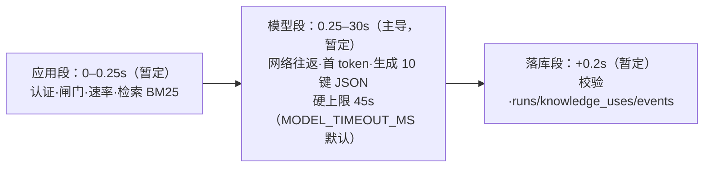

# ⑤ 性能与模型路径设计（Performance & Model Path Design）

- **日期：** 2026-11-20
- **状态：** 设计稿。所有数字分两类：【已有依据】= 代码/文档中可核查的配置或实测记录；【暂定假设】= 基于产品假设的工程估计，必须实测后修正。
- **纪律：** 不伪造测量；区分应用响应时间与模型服务时间；影子评估不经授权不接触真实业务数据（现状代码已强制：typesafe 影子仅限样本工单且 applied:false）。

---

## 1. 请求生命周期与延迟预算（现状 vs 目标）

### 1.1 现状一次组织模式运行的路径（【已有依据：代码路径核查】）

**时间轴读法（组织模式单次运行，秒为暂定假设，超时上限为已有依据）：** 应用段与落库段合计 <400ms（暂定）——端到端等待几乎全部由模型段构成；这决定了优化主攻方向是分层路径与模型并发管理，不是应用微优化。延迟预算表：

| 段 | 预算 | 依据 |
|---|---|---|
| 认证+闸门+速率检查 | < 50ms | 【暂定假设】纯内存/SQLite 点查 |
| 检索（语料 ≤ 数千条） | < 200ms | 【暂定假设】JS BM25 O(N)，试点规模（<100 卡）实测感知为瞬时；上限包络见 §5 |
| 模型网络往返 + 首 token | 1–10s | 【暂定假设】远程 LLM 常见量级，未实测 |
| 模型生成（4096 token 上限，实际约 1–2k） | 5–30s | 【暂定假设】 |
| 输出校验+落库+事件 | < 100ms | 【暂定假设】SQLite 单写者 |
| **合计端到端** | **6–40s**，硬上限 45s（MODEL_TIMEOUT_MS 默认） | 超时为【已有依据：config 默认值】 |

**关键区分：** 应用自身开销（闸门+检索+落库）合计 <400ms（暂定），端到端等待 ≈ **模型服务时间**。因此"优化应用代码"对体感收益有限，收益来自分层路径与并发模型。

### 1.2 产品负载模型（假设驱动，全部【暂定假设】，待试点实测替换）

| 假设项 | 取值 | 来源 |
|---|---|---|
| 团队规模 | 5–10 成员 | research/06 产品定义（小型客服/IT 团队） |
| 日工单量 | 20–100 | 暂定假设 |
| AI 运行比例 | 50–100% 工单各 1–2 次 | 暂定假设 |
| 峰值并发模型调用 | ≤ 4 | 10 人同时点击 ≈ 少数并发 |
| 单模型调用 token | 输入 2–4k（含检索上下文）/ 输出 1–2k | 提示词 v4.0 长度 + 4096 输出上限【已有依据：上限】 |
| 日模型调用 | 30–200 次 | 上限 60/h × 工作时长 |
| SQLite 写入 | 每运行 ~10 行 + 事件 | 小 |
| 检索语料 | 试点 <100 卡 → 千卡量级远期 | 暂定 |

**结论（工作负载推论）：** 瓶颈是**模型串行时长**与**模型费用**，不是数据库或 CPU。SQLite 单写者在 10 人团队下毫无压力（WAL 模式读写并发，写入为毫秒级短事务）。

---

## 2. 分层响应策略（快路径表）

| 层 | 适用任务 | 机制 | 触发条件 | 状态 |
|---|---|---|---|---|
| L0 缓存/规则 | 完全重复工单、纯分类 | 内容哈希/完全同题规则 → 立即返回（标记 path=fast_cached，origin=cached，UI 明示"缓存复用（历史已审建议）"） | 输入完全相同且来源工单已解决已审 | 【已实现 2026-11-20，P4】 |
| L1 本地小模型 | 低风险分类/提取/路由/格式检查 | 环回 HTTP 本地模型，不出内网 | 主模型延迟数据证明分类场景占比高后启动评估 | 【暂缓，ADR-5】 |
| L2 主模型 | 综合建议（默认路径） | llm.js → 远程 HTTPS | 授权+速率通过 | 【已有依据：已实现】 |
| L3 人工 | 低置信/权限/安全/高影响/escalation_needed | UI 标注 + 事件 | 输出 uncertain 或升级信号 | 【已有依据：escalation_needed 已在输出结构中】 |

**降级顺序（故障时）：** 主模型不可用 → 显式无回答占位（现状）→ 团队转纯人工流程（工单系统功能不受影响）。**绝不静默降级为低质量路径**；L0 命中必须在 UI 明示"来自历史相似工单的已审建议"。

---

## 3. 路径对比评估（决策支持，复述 ③流程 4 的表并给出选择）

| 维度 | 串行主模型（现状） | 并行对（demo） | 级联（分类→定向检索→主模型） | 影子评估 |
|---|---|---|---|---|
| 端到端延迟 | 基准（6–40s 暂定） | max(两者)，无增益 | +一次分类调用（快） | 0（旁路） |
| 成本 | 基准 | 2× | 1.2×（暂定） | +旁路调用 |
| 故障率 | 超时即整体失败 | 单边失败仍出一边 | 级联头失败可跳过级联 | 不影响主路径 |
| 数据暴露 | 全文送远程 | 2× | 同串行 | **未经授权仅限样本** |
| 质量 | 基准 | 对照观察（研究价值，非生产） | 检索更准（理论上） | 校准路由阈值 |

**决策：** v1 生产路径 = 串行主模型 + L0 规则快路径（仅重复场景）；并行对保留为 demo 观察模式；级联待实测分类质量后评估；影子评估维持"样本-only + 永不生效"（改此约定需新 ADR）。

---

## 4. 超时 / 重试 / 断路 / 队列 / 限流策略（现状→目标）

| 机制 | 现状 | 目标（本设计） | 触发重新评估 |
|---|---|---|---|
| 超时 | 模型 45s（AbortController）【已有依据】 | 不变；前端运行请求超时提示与可重试；交接/审核等操作无模型依赖不受影响 | 实测 P95 > 30s 时缩短模型超时并先出"部分结果" |
| 重试 | 无 →【已实现 2026-11-20，P4：1 次同参重试 + output_retry 痕迹】 | 输出校验失败允许 1 次同参重试（防结构抖动）；网络错误不自动重试（费用不可控），由用户显式重试 | 实测结构失败率 >5% 时加自动重试 |
| 取消 | 无 | 前端"取消等待"= 放弃本轮（服务端继续完成落库，结果仍可查——避免已付费无记录） | — |
| 断路器 | 无 →【已实现廉价替身，P4】 | 连续失败计数 → /api/state.modelHealth + UI 提示（成功清零，不阻断） | 日调用 >500 或多模型端点时引入真断路器 |
| 队列 | 无（请求线程内同步） | 暂不加队列：10 人团队并发 ≤4，Node 单线程排队即天然队列；**加队列的触发条件**：并发运行 >10 或需要后台批量运行（ADR-6） | — |
| 限流 | MODEL_MAX_CALLS_PER_HOUR=60 滚动窗口持久化【已有依据】 | 不变；429 响应带重置时间 | 团队确认更高配额 |
| 幂等 | 无 →【已实现 2026-11-20，P1】 | 运行去重（④§4.3：90s 内同工单拒绝新运行，runs 表级判断） | — |
| 并发上限 | 无显式 →【已实现 2026-11-20，P4】 | 服务端同时进行中的模型调用计数 >5 时返回 429「模型服务繁忙」（MODEL_BUSY，预留额度失败也计数） | 试点实测 |

---

## 5. 本地模型任务适配与拒绝条件（为 ADR-5 预研）

**适合本地小模型（若未来引入）：** 工单分类（标签枚举）、敏感信息预检（正则+分类器双通道）、重复工单聚类、格式检查。特征：输入短、输出小、错误可被人工审核纠正、无综合推理。

**拒绝条件（任一命中即回主模型或人工）：**
1. 输出将直接展示给客户（权限阶梯不允许）；
2. 涉及授权/脱敏判断（安全边界必须人工或主模型+审计）；
3. 本地模型置信度低于阈值（阈值待标注数据）；
4. 本地服务不可用——**降级顺序**：本地失败 → 主模型（若授权允许）→ 人工，不得阻塞任务。

**数据暴露对比：** 本地模型 0 外发（数据不出宿主）；远程主模型发送工单全文（需六项闸门）。这是本地路径的核心价值，也是其延迟/质量代价的交换理由。

---

## 6. 质量/延迟/成本/升级率的联合评估框架

单指标优化都会破坏其他指标，评估必须是四元组。定义（全部可从 ④§6/§7 的记录派生）：

- **质量：** 人工采纳率（adopt+edit ÷ 已审，分 human 来源桶）、编辑幅度（edited_text 与 draft_reply 差异度，暂定编辑字符比例）、重开率、helpful 率。
- **延迟：** runs.latency_ms（【已有依据：已记录】）按 path/mode 分桶的 p50/p95；区分闸门前耗时与模型耗时（【已实现 2026-11-20，P2】latency 拆为 gate_ms + retrieve_ms + model_ms 三列落库，P4-7 报表按 path/mode 分桶输出 avg）。
- **成本：** 日调用数（滚动计数已持久化）+ token 列（④§7）× 配置单价。
- **升级率：** escalation_needed 占比 vs 实际 escalated 状态占比（AI 判断与人工判断的偏差，本身就是质量信号）。

**评估节奏（建议，待用户确认）：** 每试点周出一次四元组报表（analytics 只读层扩展，不新建管道）；任何路径/模型/提示词变更前后各一轮对比。

---

## 7. 性能验证计划（无伪造数字的边界）

| 验证项 | 方法 | 状态 |
|---|---|---|
| 应用层基线（闸门+检索+落库） | **已实施 2026-11-20**（`scripts/perf-baseline.js`）：非模型 API p50 = 4ms【本机已验证，SLO <300ms 大幅达标】 | ✅ |
| 模型延迟分布 | 试点批次 runs.latency_ms 现成数据汇总（pilot-2026-11 的 20 次运行） | 数据在库，分析待用户授权只读查询 |
| 检索包络 | **已实施 2026-11-20**（同脚本，合成中文语料 5 轮中位）：**1k 卡 p50=133ms（SLO <500ms 达标）；5k 卡 p50≈28s；10k 卡 p50≈110s** ——当前 BM25 无预索引（每次检索全量重 tokenize），>1k 卡即超可用阈值。**结论：试点规模（<100 卡）余量充足；语料增长到千卡级前必须完成预索引或向量检索（ADR-007 重评条件的数据依据已到位）** | ✅ 数据已记录 |
| 并发模型调用 | **已实施 2026-11-20**（mock 端点 + 本地 live 路径）：延迟拆分三列落库自洽（gate/retrieve/model + tokens）；demo 口径并发不受限为设计行为，**产品模式 429 端到端验证需 product 实例（列入 P6 前置核对清单）** | ✅（429 端到端待 P6） |
| SLO 草案 | 见下表 | 【暂定建议】，试点后修订 |

**SLO 草案（全部【暂定建议】，标注依据后生效）：**

| 指标 | 目标 | 依据状态 |
|---|---|---|
| 非模型 API（CRUD/检索页）p95 | < 300ms | 暂定假设（单机 SQLite 应轻松满足） |
| 模型路径 p95 | < 45s（超时上限内），中位 < 20s | 暂定假设 |
| 检索（组织记忆页搜索）p95 | < 500ms @ 1k 卡 | 暂定假设 |
| 可用性（工作日） | ≥ 99%（单实例，重启 < 30s） | 暂定假设 |
| 模型失败可感知率 | 100%（失败必须显式可见，零静默） | 【已有依据：架构保证】 |

**负载测试纪律：** 只用合成/虚构数据；不触真实服务端口（4173/4182/4186/4192/4193/4195）；不在未授权时调用付费模型端点（模型延迟用 mock 端点或试点历史数据）。
