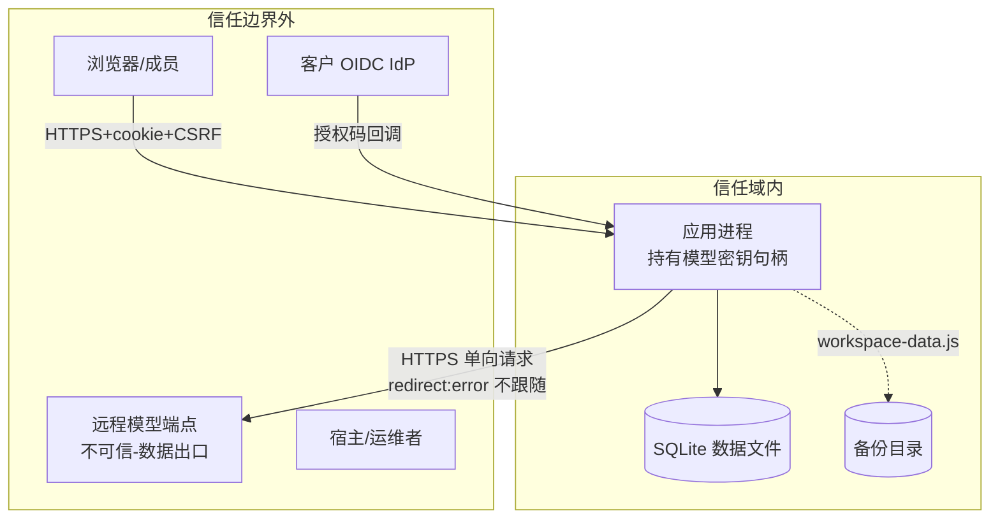

# ⑥ 安全与运行设计（Security & Operations Design）

- **日期：** 2026-11-20
- **状态：** 设计稿（2026-11-20）。§1–§5 现状（已实现，证据附后）；§6–§8 本设计新增。**实现状态更新（2026-11-20，P5 落地）：§3 恢复演练已脚本化（scripts/acceptance.js，14/0【本机已验证】）、§5 监控包三项已实现（备份新鲜度/连续失败计数/升级手册 deploy/UPGRADE.md）——标记见各表。**
- **定位：** 当前应用是学习与机制实验台（AGENTS.md 明文），本文的安全设计目标是"单团队受控试点够用 + 未来可评测加固"，不声称达到外部生产级。

---

## 1. 威胁边界与信任模型



**信任假设（明文化）：**
1. 浏览器到服务器的通道由 TLS 反代/宿主保证（应用自身按 product 强制 HSTS；本地 demo 允许 HTTP 仅限环回）【已有依据：config/llm 本地模型允许环回】。
2. 远程模型端点是**数据出口**：工单正文经六项授权闸门后全文送出；模型返回内容视为不可信输入（服务端校验后落库，前端 esc() 转义渲染——XSS 主防线在客户端转义 + CSP）【已有依据：CSP script-src 'self' 无内联脚本】。
3. 运维者可信但对**业务数据**无特殊通道：备份文件仍受文件系统权限保护；erase 需确认词+服务停止校验【已有依据：workspace-data.js】。
4. OIDC IdP 由客户自备；应用只信任 (issuer, subject) 身份断言，邮箱仅用于邀请匹配【已有依据：auth.js】。

---

## 2. 模型输入 / 日志 / 密钥保护

### 2.1 模型输入边界（现状机制总表）

| 闸门 | 内容 | 证据 |
|---|---|---|
| 范围闸门 | pilot 范围工单才能送远程模型；sample 数据永不送出 | pilotRunGate 检查 1 |
| 来源闸门 | source_ref 已登记 | 检查 2 |
| 存储确认 | authorized_by（独立于发送确认） | 检查 3 |
| 脱敏闸门 | desensitization ∈ done/not_needed（partial/unknown 拒绝） | 检查 4 |
| 授权登记 | model_authorized_by 由 admin 登记 | 检查 5 |
| 目标绑定 | 授权时端点+模型快照与当前活跃配置匹配（尾斜杠归一），换目标即失效 | 检查 6 |
| 速率 | 60 次/h 滚动持久化，429 不调用 | config/api |
| 传输 | 远程强制 HTTPS（本地模型仅环回 HTTP）；URL 拒绝 userinfo/query/fragment；redirect:'error'；不回显提供商错误正文 | llm.js/config.js |
| 密钥 | MODEL_API_KEY / *_FILE 互斥；compose secrets 注入；代码库/日志无密钥 | config readSecret |
| 输出上限 | 4096 tokens | config |

### 2.2 日志与审计载荷保护

- 现状：events.payload 只存 id/状态/计数（④§3.2 核查）；错误日志 `[api]` 行包含 err.message（服务端本地日志，含内部信息可接受；**不再进入 API 响应**——④§4.2 修复）。
- 【已实现 2026-11-20，P1 + 设计保留】规范成文：
  1. payload 白名单已在写入点强制（event-kinds.js，28 kind × 白名单字段，白名单外抛错）；敏感字段永不进入 events.payload、备份 manifest、模型提示词——只存在于对应事实表（既有核查口径不变）；
  2. 错误日志 `[api] <errorId>` 行含 err.message（服务端本地日志可接受）；API 响应只回固定文案 + errorId（④§4.2 已实现）；
  3. 导出（/api/admin/export）包含全部事实表 = 全量业务数据，必须 adminOnly + 事件记录（均已实现），导出文件由管理员自行保护。

---

## 3. 备份 / 恢复 / 数据删除边界

| 操作 | 机制 | 证据 |
|---|---|---|
| 备份 | `workspace-data.js backup`：node:sqlite backup API，只接受无 sample 数据的团队库；先 integrity_check + foreign_key_check + schema 校验 | scripts/workspace-data.js |
| 校验 | `verify`：清单含 FORMAT 标识与哈希 | 同上 |
| 恢复 | `restore` 仅到**新目录/空目录**，不覆盖 | 同上 |
| 删除 | `erase` 需 `--service-stopped` + 精确确认词 `DELETE <canonical DATA_DIR>`；锁文件校验（PID 存活检查） | 同上 |
| 容器侧 | 数据卷 product-data + BACKUP_DIR bind（宿主保护目录）；read_only 容器内应用不可删备份 | compose.yaml |
| 运行时备份缺失 | 【已实现 2026-11-20】`BACKUP_DIR` 配置 + `/api/state.backupFreshness`（读备份目录 manifest 清单，报告距上次成功备份天数）+ 设置页准备清单告警条；超 7 天 stale（暂定阈值）；未配置不显示（不猜测部署策略） | server/config.js、server/api.js、public/app.js |
| 模型失败连续计数 | 【已实现 2026-11-20】进程内计数（成功清零）→ `/api/state.modelHealth` → UI toast，只提示不阻断 | server/api.js、public/app.js |

**恢复演练（已脚本化 2026-11-20）：** `scripts/acceptance.js`——临时实例（系统临时目录 DATA_DIR）从零启动→迁移→全流程冒烟→backup→verify→restore→指标断言，**14 通过 / 0 失败**【本机已验证】。备份演练用应用真实迁移器生成无 sample 替身库（备份工具正确拒绝残缺 schema——防线按设计生效）。不在生产数据上演练；erase 分支保持人工显式确认（`--service-stopped` + 确认词），不进自动化演练。

---

## 4. 失败恢复与重复预防

- **崩溃恢复：** SQLite WAL——进程崩溃后未提交事务自动回滚，已提交数据在 WAL 中；重启即恢复（现状依赖此机制，无需额外设计）。
- **锁文件：** DATA_DIR/app.lock（PID+token）防双实例写同一库；过期锁需人工确认【已有依据：config/index】。
- **重复预防：** 见 ④§4.3（运行去重、审核权威=最大 id、交接去重 prepared_event_id）。
- **数据库↔检索一致性：** 无独立索引，写库后查询即新值（单进程），无一致性缺口【现状】；未来加缓存时的三重保障见 ④§5。
- **升级失败回退：** 迁移全部是幂等加列（旧镜像可跑新库）→ 回退 = 换回旧镜像启动【已有依据：迁移模式】。

---

## 5. 监控 / 告警 / 排障

**现状（够试点用）：** /api/health（存活）、/api/ready（库+模型配置）+ compose healthcheck 自动重启；服务端 stdout 日志；workspace_profile/事件时间线可人工排障。

【最小监控包】（避免过度建设）：

| 项 | 实现 | 理由 |
|---|---|---|
| 模型失败连续计数 | 【已实现 2026-11-20】进程内计数（成功清零）→ `/api/state.modelHealth` → UI toast，只提示不阻断 | 断路器的廉价替身 |
| 备份新鲜度 | 【已实现】/api/state.backupFreshness + 设置页告警（§3） | 防从未备份 |
| 事件量异常 | 无独立告警；观察页人工巡查 | 试点规模不需要 |
| 每实例升级清单 | 【已实现】deploy/UPGRADE.md 逐台升级清单模板（§7） | 多团队时必需 |

**排障路径（现状已可用）：** 事件页（events 时间线）→ 工单详情（完整运行/审核链）→ 服务端日志。排障不读 .env、不直连客户库（只读查询需用户逐次授权）。

---

## 6. 身份与权限（现状总表，含本地可验证/需真实环境验证的区分）

| 项 | 现状 | 验证等级 |
|---|---|---|
| OIDC 授权码+PKCE、(issuer,subject) 身份、8h 会话、10min 流程、邀请 7 天、`__Host-` cookie | auth.js | 本机已验证（模拟 OIDC）；**真实客户 IdP 未验证**（不得猜测客户 IdP，接入属部署期工作） |
| CSRF 全覆盖非 GET；demo 存根放行 | api/auth | 代码确认 |
| 角色三级 + adminOnly 白名单 + viewer 拦截 | api.js | 代码确认 |
| 手填姓名仅归属；审核绑定登录成员 id | REVIEWER_REQUIRED | 代码确认 |
| 静态文件路径遍历防护（decode+拒绝\0+resolve 边界+hash 回退） | index.js | 代码确认 |
| CSP 无内联脚本 / HSTS / MIME / frame-ancestors none | SECURITY_HEADERS | 代码确认 |

**本地可验证 vs 需真实环境验证清单（路线图引用）：**
- 本机可验证：全部功能路径（mock OIDC/演示模式）、备份恢复演练、并发冒烟、失败路径。
- 需真实环境：客户 IdP 实联、真实团队权限体验、反代 TLS 实联、模型端点实联（付费）、真实数据授权流程（需团队负责人签字式确认——UI 已有流程，未实测）。

---

## 7. 升级 / 回退流程（单实例 → 多实例）

**单实例（现状可用）：** 拉新镜像 → `workspace-data.js backup` → 换容器 → /api/ready 通过 → 冒烟断言 → 失败则旧镜像+恢复目录重启。

【多实例升级（阶段 B 运维包）：升级/回退手册与逐台清单已实现（P5，deploy/UPGRADE.md）；实例清单文件 + 一键脚本推迟到真实第二个实例出现】

```
instances.list（清单：实例名/端口/DATA_DIR/镜像 tag/备份目录）
upgrade.sh --instance team-a：
  1. 读清单核对 DATA_DIR 与备份目录存在
  2. backup（校验通过才继续）
  3. docker compose pull + up -d（逐实例）
  4. /api/ready 轮询 120s + 冒烟断言
  5. 失败 → 自动切回旧 tag + 恢复提示；成功 → 更新清单 tag
drift-check.sh：对比清单 vs 容器实际 env（APP_MODE=product、HOST=127.0.0.1、密钥走 secrets 文件）
```

脚本属运维工具（deploy/ 下新增），不进入应用进程；本阶段只写设计，实施列入路线图 P5。

---

## 8. 数据保护责任分工（对齐 AGENTS.md：用户负责人工/业务决定）

| 责任 | 承担者 | 系统支持 |
|---|---|---|
| 判断哪些工单可送模型 | 团队负责人/管理员 | 授权字段+六闸门+失效机制【已实现】 |
| 脱敏执行与标记 | 处理成员 | desensitization 状态机【已实现】 |
| 邀请与停用成员 | 管理员 | invites/status【已实现】；**邀请邮件发送明确不做**（UI 明示"系统不会自动发送邀请邮件"） |
| 备份执行与保管 | 运维者（用户侧） | 脚本+校验+确认词【已实现】 |
| 密钥保管 | 部署环境 | secrets 文件，代码零接触【已实现】 |
| 审计核查 | 管理员 | events 时间线+导出【已实现】 |

---

## 9. 本文档明确的"不声称"

- 不声称防住宿主级攻击（容器加固是基线，非目标）。
- 不声称模型端点侧数据安全（出口后由客户与模型服务商协议约束——架构只能控制"送什么、何时送、谁授权"）。
- 不声称通过任何外部安全认证；试点结论不可推广为"可对外商用"。
