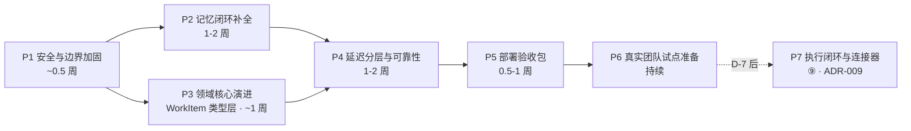

# ⑧ 分阶段实施路线图（Phased Roadmap）

- **日期：** 2026-11-20
- **状态：** 已确认（2026-11-20，D-0…D-7 全部通过）：**P1–P4 已实施并通过 smoke（42/0），P5 部署验收包已落地（acceptance.js 演练 14/0），性能基线 perf-baseline.js 11/0 补全（应用层 p50=4ms；检索包络 1k=133ms / 5k≈28s / 10k≈110s → ADR-007 实测重评依据）【本机已验证】**；下一阶段 P6 真实团队试点（用户主导启动）。**P7 执行闭环设计已确认（ADR-009 已接受），但 D-7 决定提供商暂不接——P7 推迟至真实需求出现，届时按 ⑨/④§11 实施。**
- **硬约束（来自用户）：** 每阶段独立可交付、可验收、可回退；本地代码工作**不等待**深圳活动/客户访谈/生产配置；不猜测未知客户的 IdP 与数据策略；AI 不联系真实用户。
- **排序原则：** 安全边界 → 核心工作流 → 性能可靠性 → 部署验收 → 后续扩展。
- **验证等级标注：** 每阶段完成条件区分【代码已实现 / 本机已验证 / 真实团队已验证】——当前"真实团队已验证"项为 0，这不是失败而是试点入口。

---

## 阶段总览

并行说明：P1 与 P2、P3 可同时进行（互不触同一模块核心）；P3 是 2026-11-20 领域边界修正（ADR-008）新增的阶段，落地 ②§8 的 E1–E4；P4 依赖 P2 的数据字段与 P3 的类型层（词表用于类型化术语渲染）；P5 依赖 P4 的错误规范；P6 依赖 P1–P5 全部完成，且其线下部分（团队实联）由用户安排，不阻塞 P1–P5。

> **阶段重排说明：** 原路线图 P3（延迟分层）/P4（部署验收）/P5（试点准备）在本版顺延为 P4/P5/P6；外部文档引用已同步（⑥§7、README）。

---

## P1 安全与边界加固（纯本地代码，无外部依赖）

**目标/价值：** 把权限阶梯与审计从"约定"变成"代码断言"；消除已知安全瑕疵；为后续一切阶段提供可信基座。

| 工作项 | 模块/数据变更 | 依据 |
|---|---|---|
| 1. 错误响应规范化：500 固定文案+errorId，err.message 只进日志；数据库不可用 503 | api.js 错误处理程序 | ①R4、④§4.2 |
| 2. AI actor 写断言：api.js 分发层拒绝 actor=agent:* 的任何写请求并记事件 | api.js（~10 行）+ events kind | ②§4.3、③流程 8 |
| 3. 版本一致性断言：启动时校验 UI_PROMPT_VERSION === PROMPT_VERSION（不一致拒绝启动） | agent.js/index.js（前端常量经构建注入或共享 JSON） | ①R9 |
| 4. 审计 payload 白名单成文：events 常量集中导出 + 各 addEvent 调用点对照 | store.js/各模块 | ④§3.2 |
| 5. 事件 kind 常量单点化 + UI 标签同步断言 | 新常量模块 + app.js | ④§3.2 |
| 6. 运行去重：同工单 90s 内拒绝重复运行 | api.js POST /run | ④§4.3 |
| 7. updated_at 乐观并发校验（工单 PATCH） | api.js/store.js | ④§4.3 |

**依赖/风险：** 无外部依赖；风险低（全部是小改动）。工作项 3 需要决定常量共享方式（构建注入 vs JSON 文件），实施时二选一。
**通过条件：** 冒烟脚本扩展通过（含"AI 写请求被拒""500 不回显内部信息""重复运行被拒"断言）【本机已验证】。
**回退：** 每项独立提交，git revert 即回退；无数据迁移。
**可并行事项：** 与 P2 并行。

---

## P2 记忆闭环补全（产品能力 6/7 的核心缺口）

**目标/价值：** 补齐"采用/有效"跟踪（①R1），让"组织记忆是否真的有用"从不可见到可度量——这是本产品区别于普通 RAG 的核心证据链。

| 工作项 | 模块/数据变更 | 依据 |
|---|---|---|
| 1. knowledge_uses 增列迁移：adopted/adopted_review_id/helpful/helpful_note/helpful_by/helpful_recorded_at + 索引 | db.js 幂等迁移 | ④§6.1 |
| 2. 审核回写：权威审核 adopt/edit 时回写该 run 全部 use 行；改判覆盖 | store.addReview | ④§6.1 |
| 3. 有效性标注：POST /api/uses/:id/helpfulness + 工单详情页 UI + use_helpfulness_recorded 事件 | api.js/app.js | ④§6.1 |
| 4. 派生视图：卡片 hit/adopted/helpful 计数与 helpfulRate；复核提示（只读规则） | analytics.js/记忆页 | ④§6.2 |
| 5. runs 增列 path/path_reason/prompt_tokens/completion_tokens + gate_ms/retrieve_ms/model_ms 拆分 | db.js + agent.js | ④§7、⑤§6 |
| 6. smoke 扩展：adopt→回写、helpful 标注、复核提示断言 | scripts/smoke.js | ④§6 |

**依赖/风险：** 依赖 P1 完成（审计基座）；数据全部为加列（可回退）；风险：helpful 标注增加成员操作负担 → UI 设计成工单解决后的一次性可选动作（每 use 一键三态），不做强制。
**通过条件：** 冒烟通过【本机已验证】；试点批次历史数据回填后报表可出（adopted 可从既有 reviews 重算回填，helpful 只能从标注日起）【本机已验证】。
**回退：** 新列被旧代码忽略；回写逻辑独立函数可停用。
**可并行事项：** 与 P1 并行（工项 1–2 依赖 P1 的 5 完成后合入）。

---

## P3 领域核心演进：通用 WorkItem 类型层（ADR-008 落地，2026-11-20 修正新增）

**目标/价值：** 把"客服工单"从全系统根模型降级为首个场景适配，让产品核心面向通用组织协作；为第二种任务类型（如"新产品试点准备"）提供零复制的接入路径。

| 工作项 | 模块/数据变更 | 依据 |
|---|---|---|
| 1. E1 概念重命名：任务域代码/注释/文档改用 workItem 语义（DB 列名、表名、API 路径不变） | store.js/api.js 注释与命名 + 文档 | ②§8.2 |
| 2. E2 类型层：work_item_types 描述对象（常量起步）+ tickets 加 work_item_type 列（默认 support_ticket，全量回填）+ 词表外置 | db.js 幂等迁移 + 新类型模块 | ④§10.1 |
| 3. category/urgency 词表移入类型描述对象（CHECK 保持不动，服务端按类型校验） | data-scope.js/api.js | ④§10.1 |
| 4. E3 通用读模型路由 GET /api/work-items（按类型查询，写路径沿用现有路由） | api.js | ④§10.3 |
| 5. UI 术语按类型渲染（用户永远看到"工单/试点准备任务"，不看到 WorkItem 裸词） | app.js | ②§8.4 |
| 6. E4 第二类型接入验证：以「新产品试点准备」（pilot_prep + parent_ticket_id）走通"AI 建议→人工判断→结果→沉淀→跨类型复用"全流程（虚构数据） | 类型描述对象 + tickets 加 parent 列 | ②§8.3、④§10.4 |
| 7. 核心机制护栏断言：类型适配层不得改权限阶梯/审核权威/交接验证/scope（代码注释 + 审查清单） | 任务域 | ②§8.1 |

**依赖/风险：** 依赖 P1 完成（护栏断言基础）；E1–E4 每步独立提交可回退；风险：类型层引入后 UI/文档术语不一致 → 工项 5+7 联合验收；第二种类型是虚构演示（非真实需求），保持最小实现防止过度设计。
**通过条件：** 「新产品试点准备」全流程冒烟通过且**零新机制表/复制**（仅 +1 类型行 +2 列）【本机已验证】；现有工单全部功能回归正常【本机已验证】。
**回退：** work_item_type 列被旧代码忽略；类型描述对象删除后系统回到单类型工单；parent_ticket_id 无值即无语义。
**可并行事项：** 与 P1/P2 并行；E5（表归并）不排期——仅当 ADR-008 触发条件 ② 成立时开新 ADR。

---

## P4 延迟分层与可靠性（性能主线）

**目标/价值：** 把"模型慢=整个系统慢"改为分层响应；把模型失败从"等满超时"改为可感知、可恢复；为成本优化提供数据。

| 工作项 | 模块/数据变更 | 依据 |
|---|---|---|
| 1. routeRequest 路由决策组件（v1：规则快路径——重复工单/纯分类；path 字段落库） | agent.js/新模块 | ③流程 4、⑤§2 |
| 2. 重复工单缓存命中路径（同 scope 已解决相似工单的已审建议直接返回，UI 明示来源） | 检索层 + api.js | ⑤§2 L0 |
| 3. 输出校验失败 1 次同参重试；前端取消等待（服务端仍落库） | agent.js/app.js | ⑤§4 |
| 4. 并发模型调用计数 >5 → 429；UI"模型繁忙"提示 | api.js | ⑤§4 |
| 5. 模型连续失败计数 → /api/state 暴露 + UI 提示 | api.js/index.js | ⑥§5 |
| 6. latency 拆分落库（依赖 P2 工项 5） | agent.js | ⑤§1.1 |
| 7. 四元组报表：质量/延迟/成本/升级率（analytics 只读扩展） | analytics.js | ⑤§6 |

**依赖/风险：** 依赖 P2 的列；快路径输出必须过同一校验（防"快=错"）；风险：规则快路径误判重复 → 仅在来源工单 resolved 且已审时启用，UI 明示。
**通过条件：** 本机 mock 模型端点（延迟可调）验证：快路径 <200ms（暂定阈值）、失败显式、并发 429 生效【本机已验证】；真实模型延迟分布属 P6。
**回退：** routeRequest 返回恒 main 即关闭分层（单点开关）；缓存路径独立开关。
**可并行事项：** 工项 4–5 与 P2 无冲突可提前。

> **实现状态（2026-11-20）：** 工项 1/2/4/5/7 已实现——`routeRequest()`（完全同题 + 来源已解决已审才命中，来源重开即回 main）；缓存快路径 `origin=cached/path=fast_cached` 落库 + UI「缓存复用（历史已审建议）」标注 + 单点开关（demo 对照实验恒走主模型）；并发 >5 → 429 MODEL_BUSY（预留额度失败也计数）；连续失败计数经 /api/state.modelHealth 暴露 + UI toast；四元组报表 metrics.quadruple（latencyByPath/pathCounts/escalationRate/tokens，只读派生，无数据为 null 不伪造）。工项 3（输出校验失败 1 次同参重试）已实现于 agent.js（toolCalls 留 output_retry 痕迹）；工项 6（latency 拆分落库）P2 已完成。smoke 42/0 通过【本机已验证】；mock 端点延迟阈值验证与真实模型延迟分布按设计属 P6。

---

## P5 部署验收包（单团队上线就绪）

**目标/价值：** 把"能跑"变成"敢上线"：备份可恢复、失败可观测、升级可回退，全部有演练证据。

| 工作项 | 模块/数据变更 | 依据 |
|---|---|---|
| 1. 备份恢复演练：data/.smoke 目录 backup→restore→启动→断言（脚本化，进 smoke 或独立脚本） | scripts/ | ⑥§3 |
| 2. 备份新鲜度提示（状态页显示距上次成功备份天数） | api.js/app.js | ⑥§3 |
| 3. 升级回退手册：单实例升级步骤 + 失败回退步骤（deploy/UPGRADE.md） | deploy/ | ⑥§7 |
| 4. 端到端验收脚本：新实例从零启动→seed→全流程冒烟→指标断言（compose 场景可选） | scripts/ | ⑤§7 |
| 5. SLO 数据采集：试点批次 latency 汇总报告（只读查询，授权后执行） | analytics 一次性脚本 | ⑤§7 |

**依赖/风险：** 全部本地可完成；无生产配置依赖（不猜测客户环境）。
**通过条件：** 演练脚本本机通过【本机已验证】；手册评审通过【用户确认】。
**回退：** 不适用（工具/文档阶段）。
**可并行事项：** 与 P3 后半并行。

> **实现状态（2026-11-20）：** 全部 5 项落地——①备份恢复演练已脚本化 `scripts/acceptance.js`（新实例从零启动→迁移→全流程→backup/verify/restore 演练→指标断言，**14 通过 / 0 失败**；备份工具用真实迁移器生成无 sample 替身库，符合其产品边界）；②备份新鲜度提示已实现（`BACKUP_DIR` 配置 + `/api/state.backupFreshness` + 设置页准备清单第 4 项 + 超 7 天/从未备份告警条，未配置不猜测部署策略）；③升级回退手册 `deploy/UPGRADE.md`（幂等加列=旧镜像可回退的核心保证 + 判定点 + 多实例清单 + 漂移检查）；④端到端验收即 acceptance.js 本体；⑤SLO 数据采集脚本待试点数据（属 P6 只读分析，按设计不提前实现）。

---

## P6 真实团队试点准备（用户主导，AI 支撑）

**目标/价值：** 把"本机已验证"推进到"真实团队已验证"。**本阶段由用户决定启动时机与对象**；AI 仅准备材料、不联系任何真实用户。

| 工作项 | 责任 | 说明 |
|---|---|---|
| 1. 团队准备卡使用（worksheet 已有）+ 授权流程演练 | 用户+目标团队 | 现有 team-first-session-worksheet.md |
| 2. 客户 IdP 对接（真实 OIDC） | 用户+客户管理员 | 代码已就绪；不猜测客户 IdP，按客户实际提供配置 |
| 3. 生产部署（compose+TLS 反代+secrets） | 用户/运维 | ⑥§7 手册 |
| 4. 试点执行：首批 5–10 张真实工单（授权+脱敏后） | 团队 | pilotRunGate 全程强制 |
| 5. 每周四元组复盘（⑤§6 报表） | 用户+AI 分析 | AI 只读分析已授权数据 |

**依赖/风险：** 全部外部依赖由用户掌控；AI 侧无阻塞项。
**通过条件：** 真实团队完成 ≥1 个"建议→审核→结果→沉淀→复用→有效标注"完整闭环【真实团队已验证——本路线图唯一能产生该等级的阶段】。
**回退：** 试点可随时停用模型路径（删除授权登记即全部 429），回纯人工工单模式，产品功能不受损。
**可并行事项：** 面向未来扩展（多团队运维清单脚本 ADR-001、向量检索预研 ADR-007 C 路线）仅在试点数据证明需要后启动，本路线图不排期。

---

## P7 执行闭环与工具连接器（建议域 → 执行域扩展，⑨ + ADR-009）

**目标/价值：** 把产品从"AI 建议工单处理"扩展到"AI 在权限内推进实际工作"（自然语言目标 → 周报/邮件），副作用必经人工审批，全程可审计。**启动前提：用户完成 D-7（连接器提供商/形态选择）**——本阶段在此之前不排期实施。

| 工作项 | 模块/数据变更 | 依据 |
|---|---|---|
| 1. runs 状态列 + plan 落库（queued/planning/waiting_* 九态，v1 同步运行投影为两态） | db.js 幂等加列（④§11.1） | ⑨§2 |
| 2. external_actions 表 + 生命周期（prepared→approved→executing→…，payload_hash 审批绑定） | db.js + api.js | ④§11.2、⑨§5 |
| 3. 连接器注册表（类型化描述对象，代码内常量起步；先做 docs_readonly 只读连接器） | 新模块（执行域） | ⑨§4 |
| 4. 目标解析（objective 类型 + 结构化抽取草稿确认） | work-items.js + agent.js | ⑨§3 |
| 5. 周报用例（只读聚合 + 三分层草稿 + 待补充标注） | agent.js | ⑨§6.1 |
| 6. 邮件用例（草稿→审批→执行→message_id 落库→outcome_uncertain 安全态） | 连接器 + api.js | ⑨§6.2 |
| 7. 提示注入防线（外部内容只作数据、来源标注块、指令隔离） | 连接器 + agent.js | ⑨§4.5 |
| 8. smoke 扩展：审批绑定/重放拒绝/outcome_uncertain 人工闭环断言 | scripts/smoke.js | ⑨§5 |

**依赖/风险：** 依赖 D-7（提供商选择）与真实工具账户（用户提供）；连接器凭证边界复用 MODEL_API_KEY 模式；最大风险=审批疲劳 → UI 做成一次一屏完整预览。
**通过条件：** 虚构 mock 连接器全流程冒烟通过（含 outcome_uncertain 闭环）【本机已验证】；真实提供商联调属用户依赖项，不计入本阶段。
**回退：** 连接器注册表清空即回到纯建议域；external_actions 无记录即无副作用；runs.status 默认值不改变现有行为。
**明确不做：** 插件市场、可视化流程编排、模型自由文本调 API、AI 侧自动重试副作用。

---

## 明确不做（本路线图范围外，防止蔓延）

- 不引入：消息队列、微服务、多租户、自助注册、邀请邮件、多智能体框架、前端框架迁移。
- 不做：业务代码大规模重写、依赖升级（除非安全漏洞）、`.env`/真实数据库访问、付费模型调用、对外发布。
- 不做（领域边界，2026-11-20 确认）：任意行业可视化流程搭建器、插件市场、自定义字段引擎——适配层是代码内薄包（②§8.1）。
- 不猜：客户 IdP 类型、客户数据策略、真实负载量级——全部待 P6 实际信息。

---

## 阶段与 ADR/审计风险对照

| 阶段 | 消解的审计风险 | 依赖的 ADR |
|---|---|---|
| P1 | R4 R9 + 权限断言 | 002 |
| P2 | R1（主缺口） | 004（事件约定） |
| P3 | 领域边界修正（ticket→WorkItem 核心，ADR-008） | 002 008 |
| P4 | R2 R3 R6 | 003 005 |
| P5 | R7 R8 部分证据化 + R11 运维包（备份/演练/手册） | 001 006 |
| P6 | R7 R8 收尾证据化 + R11 演进路径由试点数据决定 | 001 006 007 008 |
